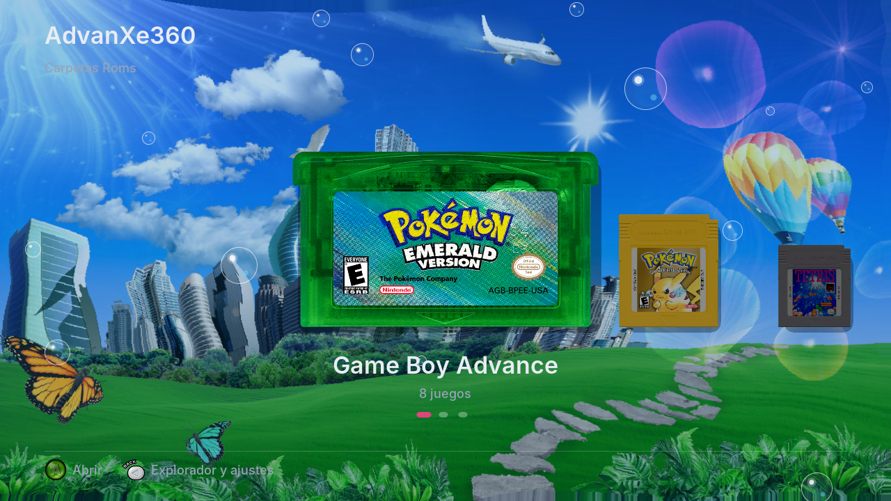
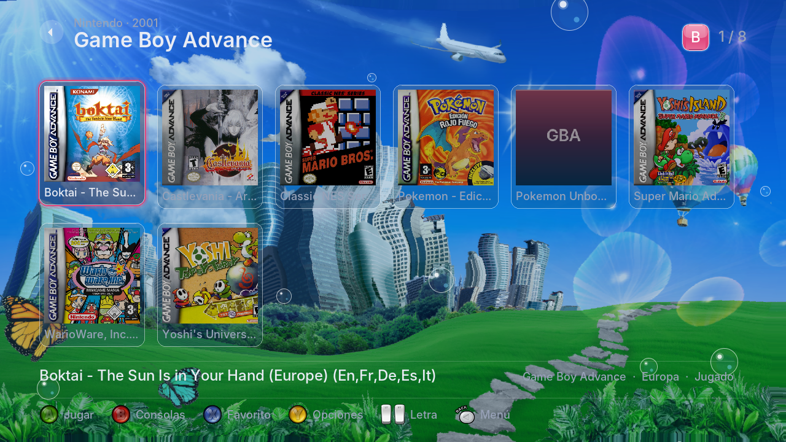
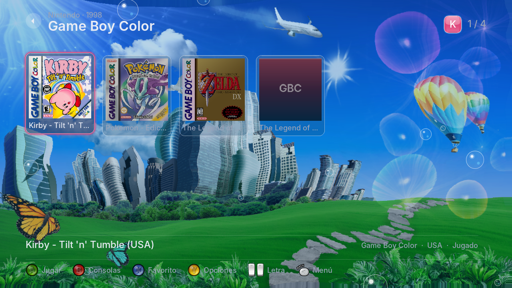
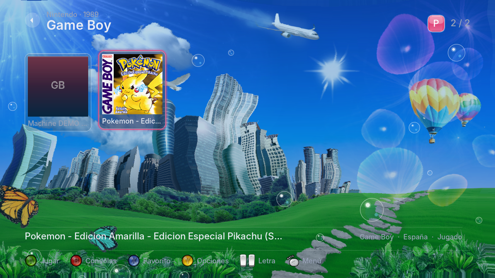
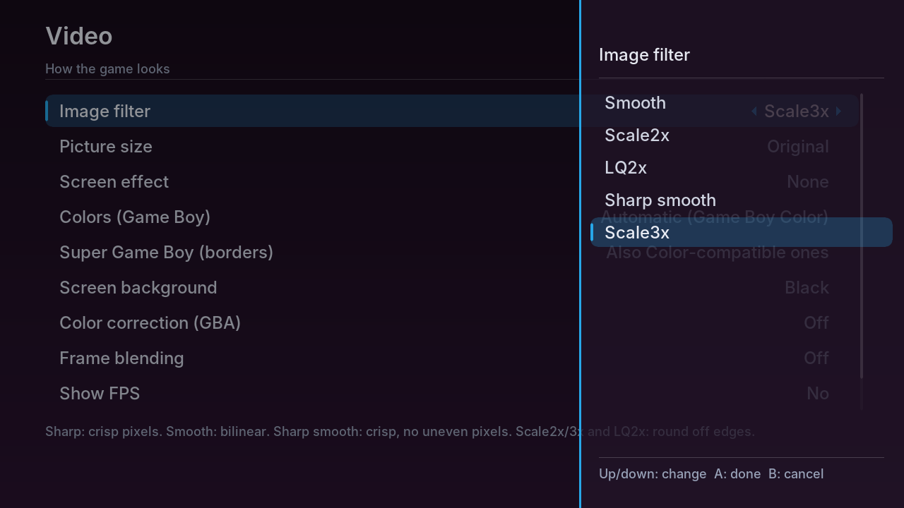
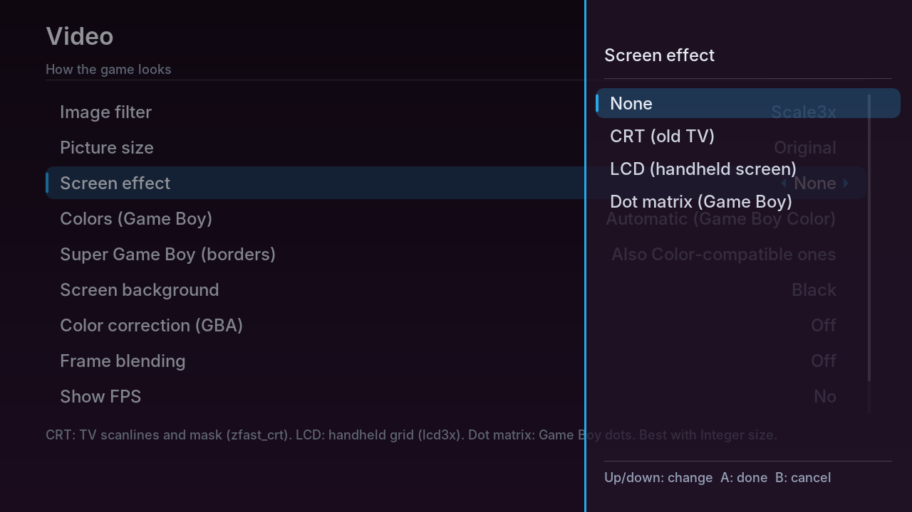
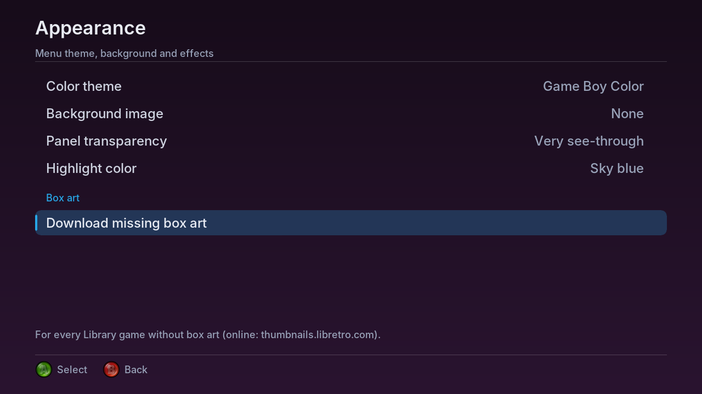
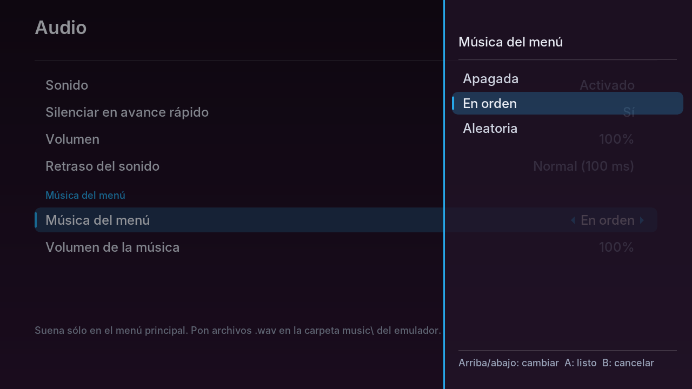
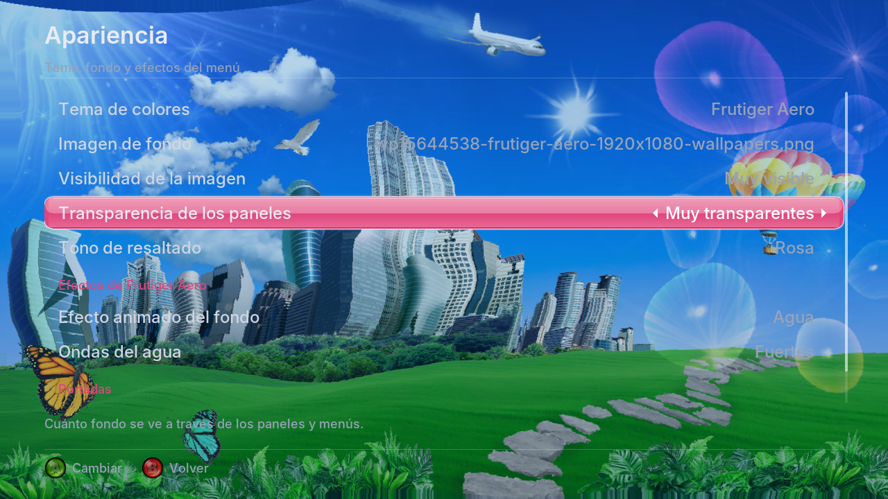
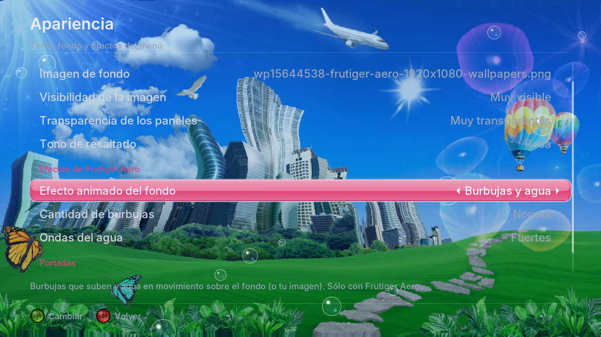

# AdvanXe360

🌐 **English** · [Español](README.md)

**AdvanXe360** (*Advance* + *Xe* from **Xenon**, the Xbox 360's processor; formerly *VBA360 enhanced-ai*) is a **Game Boy Advance, Game Boy and Game Boy Color emulator for the Xbox 360** (homebrew: BadUpdate, RGH or JTAG). Based on VisualBoyAdvance-M, with the **Gambatte** core for Game Boy / Color, **Super Game Boy borders**, its own menu and per-game options.

Fork of [frankischilling/vba360-enhanced](https://github.com/frankischilling/vba360-enhanced) · **[⬇️ Download the latest release](https://github.com/ZenithUzu/AdvanXe360/releases/latest)**

| | |
|---|---|
|  |  |
|  |  |

*All screenshots come from a real Xbox 360 (taken with Aurora). These four show the four things it runs: GBA, Classic NES Series, Game Boy Color and Super Game Boy.*

> 🤖 The changes in this fork were made with the help of artificial intelligence (Claude, by Anthropic). I maintain it as a **hobby**, non-commercial and with no warranty. You are free to use, copy, modify and share it under the GPL license.

---

# Features

- **GBA** on the VBA-M core, faster and more compatible thanks to VBA-Next improvements. **Classic NES Series / Famicom Mini** games now start.
- **Game Boy and Game Boy Color** on **Gambatte** (RetroArch's core), including Color-only games.
- **Super Game Boy:** the border and colors each game came with.
- **Hacks:** automatic **BPS / UPS / IPS** patches and save type read from the ROM (Pokémon hacks save properly).
- **Cartridge sensors** on the right stick: sun (Boktai), tilt (Yoshi, Koro Koro, Kirby Tilt 'n' Tumble), gyroscope and rumble (WarioWare: Twisted!, Drill Dozer).
- **States** in 9 slots with thumbnails, save on exit and **continue where you left off**.
- **Fast forward** from 2x to 8x or max (hold or toggle), **cheats** (GameShark, Action Replay, CodeBreaker, Game Genie) and an adjustable **clock**.
- **Audio:** volume from 25% to 200%, adjustable sound latency and **menu music** with your own `.wav` files.
- **Safe saves:** an automatic `.sav` backup every time a game is opened, plus options to delete broken states or reset all settings.
- **Picture:** filters (sharp, smooth, **sharp smooth**, **Scale2x**, **Scale3x** —those three on the GPU— and LQ2x), sizes (original, full screen, integer and 16:9), **CRT / LCD / Dot matrix** effects, GBA **color correction**, **frame blending**, 41 Game Boy palettes and a background with your own image.
- **Per-game options:** picture, buttons, cheats, save type and patch, stored by file name.
- **Library:** it starts by picking the console by its cartridge and shows your games as **cards with box art**, no folders. Box art downloads on its own and the cartridges can be customized.
- **Its own menu** in English and Spanish, with 7 themes (including **Frutiger Aero**), transparency and highlight color to taste, background image, **moving bubbles and water**, search and favorites.

## Library

| | |
|---|---|
|  |  |
|  |  |

These show the **Library**, the screen it starts on: first you pick the console by its **cartridge** (here with custom cartridges from `carts\`), then you see the games as **cards with their box art**; the chosen one is highlighted and a heart marks favorites. All with the **Frutiger Aero** theme and a background of your own.

## Game Boy Advance

| | |
|---|---|
|  |  |

These show GBA games: *Castlevania: Aria of Sorrow* as is, and *Pokémon Unbound*, a hack opened as a **clean ROM + `.bps` patch** with the same name (the patch is applied on its own, in memory).

| | |
|---|---|
|  |  |

These show **Classic NES Series** (*Super Mario Bros.* for GBA): it didn't start before; now it reaches the title screen and plays.

## Game Boy, Game Boy Color and Super Game Boy

| | |
|---|---|
|  |  |

These show the **Gambatte** core: *Zelda: Link's Awakening DX* in color and *Pokémon Crystal*, a **Game Boy Color-only** game that didn't run before.

| | |
|---|---|
|  |  |

These show *Pokémon Yellow*'s **Super Game Boy border**: the first one on a black background, the second one with your own background image on the sides.

## Cartridge sensors

| | |
|---|---|
|  |  |
|  |  |

These show the **sensors**: on top, *Boktai* with the on-screen sun meter (*Luz solar 0/10*, raised and lowered with the right stick) and *Yoshi Topsy-Turvy*, tilted with the stick. Below, the *Motion sensors* section of Controls and *Kirby Tilt 'n' Tumble* (GBC)'s own controls, which only show tilt because that cart has no sun sensor.

## Picture: effects, colors and backgrounds

| | |
|---|---|
|  |  |
|  |  |

These show the **picture** options: on top, the **LCD** effect with GBA **color correction** (less garish colors, like the real screen); below, Game Boy games at their original size with your own **background image** on the sides.

| | |
|---|---|
|  |  |
|  |  |

These show **Game Boy effects and palettes** in *Pokémon Red*: no effect with the gray palette, **CRT** with the green palette and **LCD** with the Pocket and Light palettes.

| | |
|---|---|
|  |  |

These show the **filters** (sharp, smooth, Scale2x, LQ2x, **sharp smooth** and **Scale3x**) and the **effects** (CRT, LCD and the Game Boy's **dot matrix**). Mix them as you like, on GBA, GB and GBC, and per game too.

## Menu and settings

| | |
|---|---|
|  |  |
|  |  |
|  |  |

These show the **Settings** screens (here in Spanish): Video, Audio (volume and latency), Emulation, Saving (with *Troubleshooting* to delete broken states), Interface & language and the custom **clock** for games such as Pokémon Emerald.

| | |
|---|---|
|  |  |
|  |  |

These show the **per-game options** (**Y** on a game): the *Custom* picture (Super Game Boy mode, filter, size, effect, frame blending, FPS and frame skip for that game only), **cheats** and a Game Boy Color game's **own buttons**.

| | |
|---|---|
|  |  |
|  |  |

These show **how an option is changed**: with the **side panel** or the **pop-up list** (A opens the values, B cancels), picking a background image, and the menu opened **over the game** (right stick click).

| | |
|---|---|
|  |  |
|  |  |
|  |  |

These show the **themes**: Default, Red, Game Boy Advance and **Frutiger Aero** (glass buttons and bubbles); below, the menu with your own **background image** and the menu in **English**.

| | |
|---|---|
|  |  |
|  |  |

These show **Appearance** (theme, background, panel transparency, highlight color and *Download missing box art*), the **menu music** in Audio, and Frutiger Aero with your own background, very see-through panels and the **bubbles and water** effects.

---

# Installation

1. Download the `.zip` from the [latest release](https://github.com/ZenithUzu/AdvanXe360/releases/latest).
2. Copy the `AdvanXe360` folder to your console (for example `Hdd1:\Emulators\AdvanXe360\`) over FTP or USB.
3. Open it from Aurora (`default.xex`). The other folders are created on their own.
4. Put your ROMs anywhere (hard drive or USB) and browse to them from the emulator. `.zip` and `.7z` work too.

# Usage

**In the game list**

| Button | What it does |
|---|---|
| A | Play / open folder |
| B | Go up a folder (or clear the search) |
| X | Add to / remove from favorites |
| Y | Game options |
| BACK | Search (the list filters as you type; START searches) |
| START | Change the order (A-Z, Z-A, recent) |
| LT / RT | Jump to the previous / next letter |
| LB / RB | Tabs: Games · Recent · Favorites · Settings |

**In game** (everything can be changed in *Settings → Controls*)

| Button | What it does |
|---|---|
| D-pad or left stick | D-pad |
| B / A | GBA A / B button (Nintendo layout) |
| LB / RB | L / R (GBA only) |
| START / BACK | Start / Select |
| Y / X | Turbo A / Turbo B |
| RT | Fast forward |
| Right stick click | Menu: states, cheats, options, screenshot, restart and quit |
| (unassigned) | Quick save and quick load: assign them in *Controls* |
| Right stick | Sensors (only in the games that have them) |

**Options**

- **Settings** (every option has a help line):

| Screen | What's in it |
|---|---|
| Video | Filter, size, CRT / LCD effect, Game Boy colors, Super Game Boy, background and its fit, color correction, frame blending, FPS and frame skip |
| Audio | Sound, mute while fast-forwarding, volume and sound latency |
| Emulation | Fast-forward speed and mode, original BIOS and 16-digit code format |
| Saving | Save and state folders, save state on exit, continue where you left off, `.sav` backups and delete all states |
| Controls | Every button (turbo, fast forward, menu and quick save / load too) and the sensors |
| Game clock | Console time or a custom date and time |
| Interface & language | Language, show only games, how an option is changed, theme, background image and reset everything |

- **Game options** (Y on a game, or in the in-game menu): save type and clock (GBA), patch, cheats, **picture** (*As in Settings* or *Custom*) and **buttons** (*As in Settings* or *Custom*).
- **Cheats:** typed with the on-screen keyboard or imported from `.cht` / `.txt` (RetroArch's too). Each game keeps its own list, separate for GBA (`cheats\gba\`) and GB/GBC (`cheats\gb\`).

# Tips, tricks and common issues

## Hacks and patches

- **Already-patched hack (`.gba`):** open it like any game. It runs best.
- **Clean ROM + patch:** put them together with the **same name** (`Pokemon Unbound.gba` + `Pokemon Unbound.bps`). The patch is applied when you open it (up to 32 MB) and the ROM isn't changed. Patches can cause FPS drops; if so, use the patched ROM (*Game options → Save patched ROM* while playing).

## Background around the game

Put images (PNG, JPG, BMP, TGA or DDS; 1280×720 is best) in `borders\` and pick them in *Settings → Video → Screen background* (*Centered*, *Fill* or *Stretch*). There's a sample in [`extras/borders/border.png`](extras/borders/border.png). The game covers this rectangle of a 1280×720 image:

| Console | Size | Game rectangle (x, y, width × height) |
|---|---|---|
| GBA | Original | 100, 0, 1080 × 720 |
| GBA | Integer | 160, 40, 960 × 640 |
| GB | Original / Integer | 240, 0, 800 × 720 |
| GBA and GB | Full screen | 80, 40, 1120 × 640 |
| GBA and GB | 16:9 | the whole screen |

## Menu: themes, background and covers

- **Menu theme and background:** menu images go in `backgrounds\`. In *Settings → Appearance*: theme, background image, **Image visibility** (how much of your image shows), **Panel transparency** and **Highlight color** (the selection color, over any theme).
- **Library** (the start screen): first pick the console, each shown as its cartridge (GBA, GBC, Game Boy/Pocket, and .zip/.7z apart), sorted by file extension. Inside you see only the ROMs as cards with their box art and name, no folders; the chosen one is highlighted in the theme color and a heart marks favorites.
- **Custom cartridges:** put your own PNG pictures (with a transparent background) in the `carts\` folder next to `default.xex`: `gba.png`, `gbc.png`, `gb.png` and, for .zip/.7z, `zip.png`. Any that are missing use the emulator's generic cartridges. They look best already at the size the menu uses: **440 px wide** for `gba.png`/`zip.png` and **260 px** for `gb.png`/`gbc.png`.
- **Games folder:** by default it reads the **`Roms`** folder of every drive (for example `Hdd1:\Roms\` or `Usb0:\Roms\`) and its subfolders. To use another one, press **Y** on it in the browser (BACK). BIOS files don't show up as games.
- **BACK** opens the usual menu (file browser, Recent, Favorites and Settings); **B** on the drive list goes back to the Library. *Interface & language* → **Start screen** lets you start in the browser instead.
- **Moving background effect** (*Appearance*): rising **Bubbles**, **Water** (your background image seen through moving water, like the [snes360-enhanced](https://github.com/frankischilling/snes360-enhanced) menus; it shows over an image), **Bubbles and water**, or **None**. **Frutiger Aero** theme only; it also works over your own background image. Depending on the choice, **Number of bubbles** and **Water ripples** show up.
- **Menu music** (*Audio*): put **`.wav`** files (16-bit PCM; Audacity exports them like that) in the `music\` folder next to `default.xex`. They play only in the main menu, **in order** or **shuffled**, with their own volume; never during a game.
- **Game list preview** (*Interface & language*): *Box art or last played*, *Box art only* or *Last played only* (the picture of the last moment you played).
- **Automatic box art:** with the console online, *Settings → Appearance → Download missing box art* (every Library game that has none yet). They come from [thumbnails.libretro.com](https://thumbnails.libretro.com) (the same as RetroArch) for GBA, GB and GBC. They're found best when the ROM has its **official name** (No-Intro), e.g. `Pokemon - Emerald Version (USA, Europe).gba`; short names like `Pokemon Emerald` usually work too, but hacks or translated names don't. If that server ever stops working, another one can be set in `vba360.ini` with `cover_server=`.
- **Covers by hand:** put `covers\<ROM name>.png` (or `.jpg`), for example `covers\Pokemon Emerald.png`. About 400×400 px is enough. Downloads never replace a game's existing cover.

## Super Game Boy

In *Settings → Video → Super Game Boy (borders)*: **Off**, **Game Boy games** or **Also Color-compatible ones** (Pokémon Yellow, Gold/Silver, Zelda DX... play with the border instead of in color). Also per game: *Game options → Custom → Game mode*. It applies when the game is opened; the game itself sends the border when it starts.

## If something goes wrong

- **Broken save:** when a game is opened, a copy of its `.sav` goes to `saves\backups\` (the last 3; `-1` is the newest). Copy it over the `.sav`.
- **A game hangs when loading or opening:** *Settings → Saving → Delete all save states* removes old or broken states.
- **Something looks or acts odd:** *Settings → Interface & language → Reset all settings* goes back to defaults (saves, states and cheats stay).
- **To report a bug:** send `vba360.log` and `vba360-anterior.log` (next to `default.xex`).
- **BIOS (optional):** `bios\gba_bios.bin`, `bios\gb_bios.bin` or `bios\gbc_bios.bin`, then turn on *Use original BIOS* (Emulation).

Folders created next to `default.xex`: `saves\`, `states\`, `cheats\`, `screenshots\`, `thumbs\`, `config\`, `borders\`, `backgrounds\`, `covers\`, `music\`, `carts\` and `bios\`. Settings are still in `vba360.ini` (not renamed, so your settings stay).

# What it emulates and what it doesn't

**Yes:**
- Game Boy Advance, including **Classic NES Series / Famicom Mini**.
- Game Boy and Game Boy Color (Color-only games too), with clock and rumble.
- Super Game Boy (each game's borders and colors).
- Sensors: sun (Boktai), tilt (Yoshi Topsy-Turvy, Koro Koro Puzzle, **Kirby Tilt 'n' Tumble**), gyroscope and rumble (WarioWare: Twisted!, Drill Dozer).

**Not (yet):**
- **Link cable** and **wireless adapter** (multiplayer and trading).
- **e-Reader**, **Game Boy Camera**, **Game Boy Printer** and the Game Boy Color's **infrared**.
- Bandai's **TAMA5** cartridge (Tamagotchi).
- Full Super Game Boy: the generic border, the boot animation and sounds, and the extra sound of a few games are missing.

# Building

1. Visual Studio 2010 with the Xbox 360 SDK (tested with 21256.3).
2. Open `vba360-enhanced/vbam.sln`, pick **Release | Xbox 360** and use **Rebuild Solution** (it builds `libSDLx360` too).
3. The result is `default.xex`.

More technical details in the [original README](docs/README-original.md).

# Notes & Credits

- **AdvanXe360 (formerly vba360-enhanced-ai):** [**ZenithUzu** (ZenithARC)](https://github.com/ZenithUzu): idea, console testing, builds and screenshots.
- **AI programming:** **Claude** ([Anthropic](https://www.anthropic.com)): code changes and documentation.
- **vba360-enhanced fork:** [**frankischilling**](https://github.com/frankischilling), who fixed the port's build; the base of this project.
- **Xbox 360 port:** the authors of **VBA360** and **libSDLx360**, with support from **Team Avalaunch** and **Team XeLove**.
- **Emulator:** Forgotten (VisualBoyAdvance), the **VBA-M team** and the **VBA-GX** team.
- **Game Boy / Color core:** [Gambatte](https://github.com/libretro/gambatte-libretro), by **Sindre Aamås** and the libretro team (GPL v2). Its Game Boy palettes too.
- **Super Game Boy and MBC7 (Kirby Tilt 'n' Tumble):** adapted from [SameBoy](https://github.com/LIJI32/SameBoy), by **Lior Halphon** (MIT).
- **GBA core improvements and Classic NES Series fixes:** [VBA-Next](https://github.com/libretro/vba-next) (libretro, **Squarepusher / twinaphex**, GPL v2).
- **Cartridge sensors:** from [current VisualBoyAdvance-M](https://github.com/visualboyadvance-m/visualboyadvance-m) (GPL v2+).
- **GBA color correction:** **Pokefan531**'s *gba-color* shader.
- **Screen effects:** *zfast_crt* by **Greg Hogan** (GPL v2+) and *lcd3x* by **Gigaherz** (public domain), from [libretro/glsl-shaders](https://github.com/libretro/glsl-shaders).
- **Testing:** [gba-tests](https://github.com/jsmolka/gba-tests) by **jsmolka**, **Blargg**'s *cpu_instrs* and [dmg-acid2 / cgb-acid2](https://github.com/mattcurrie/dmg-acid2) by **Matt Currie**.
- **Game Boy sound and compressed files:** Gb_Apu, Blip_Buffer and File_Extractor by **Shay Green (blargg)**.
- **Button icons:** Xbox 360 controller images from **Microsoft**'s [Xbox 360 Controller Button Images](https://github.com/SimonDarksideJ/XNAGameStudio/wiki/Xbox-360-Controller-Button-Images) pack (XNA Game Studio), Ms-PL license ([text](vba360-enhanced/src/ui/LICENSE-ButtonImages.txt)).
- **Box art:** [libretro-thumbnails](https://github.com/libretro-thumbnails/libretro-thumbnails) by the **libretro** team and community, served from [thumbnails.libretro.com](https://thumbnails.libretro.com).
- **Scale2x / Scale3x filters:** algorithm by **Andrea Mazzoleni** (AdvanceMAME); **Sharp smooth**: the idea of libretro's *sharp-bilinear*. Rewritten for the 360's GPU.
- **Water effect:** idea from [snes360-enhanced](https://github.com/frankischilling/snes360-enhanced) by **frankischilling** (water rippling the background), rewritten for this menu.
- **Library cartridges:** the built-in ones are generic, drawn for AdvanXe360 (no logos or anyone's artwork). For realistic renders, the LaunchBox forums have some by authors like [ABeezy13](https://forums.launchbox-app.com/profile/77427-abeezy13/); download them and put them in `carts\` (not included).
- **Style of this README and the release notes:** inspired by [Pokemon-Terminal](https://github.com/LazoVelko/Pokemon-Terminal) and the [PokeRogue releases](https://github.com/pagefaultgames/pokerogue/releases).
- **Typeface:** [Inter](https://rsms.me/inter/), by **Rasmus Andersson** (SIL OFL). **Libraries:** zlib, libpng and SDL.

## Licenses

The emulator is released under the **GPL v2** ([LICENSE](LICENSE)). It has to be v2 because the **Gambatte** core and **VBA-Next** are "GPL v2 only"; VisualBoyAdvance-M is "GPL v2 or later", so it fits too. The pieces under other licenses are compatible and keep their own:

| Piece | License |
|---|---|
| VisualBoyAdvance-M, VBA-Next, Gambatte, *zfast_crt* effect | GPL v2 (or later for VBA-M and zfast_crt) |
| Super Game Boy and MBC7 (from SameBoy) | MIT |
| *lcd3x* | Public domain |
| Inter typeface | SIL Open Font License |
| zlib, libpng, SDL 1.2 | zlib, libpng, LGPL |
| Button icons (XNA; LB and RB mirrored to match the controller) | Ms-PL, in their own file (`UiGlyphs.cpp`) with their [license text](vba360-enhanced/src/ui/LICENSE-ButtonImages.txt) |
| Water effect | Our own code; only the idea comes from snes360-enhanced (none of its code or texture was copied) |
| Box art | Not shipped with the emulator: each console downloads it from libretro |
| Library cartridges | Drawn for this project, GPL v2. The ones in `carts\` are each player's own and aren't distributed |

The original project's full credits are in the [original README](docs/README-original.md).
