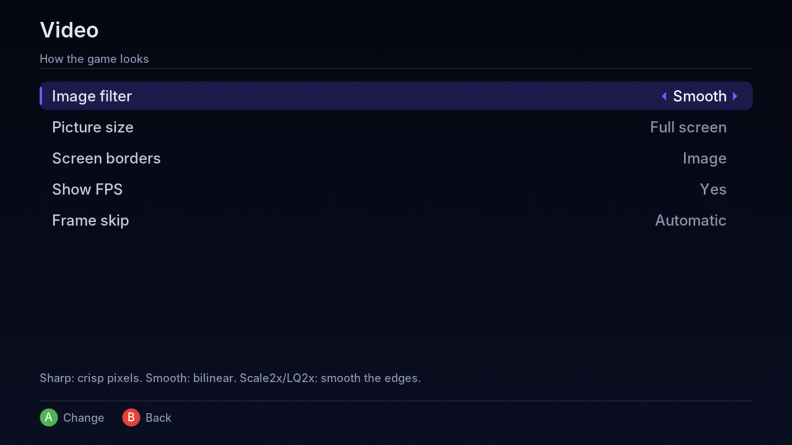

# vba360-enhanced-ai

🌐 **English** · [Español](README.md)

**Game Boy Advance emulator for Xbox 360** (homebrew; works with BadUpdate / RGH / JTAG).
Fork of [frankischilling/vba360-enhanced](https://github.com/frankischilling/vba360-enhanced).

**[⬇️ Download the latest release](https://github.com/axelconde7w7-gif/vba360-enhanced-ai/releases/latest)**

> 🤖 **Notice:** the changes in this fork were made with the help of artificial intelligence (Claude, by Anthropic). I maintain it as a **hobby**, non-commercial and with no warranty of any kind.

You are **free to use it or not**, and to copy, modify and share it under the GPL terms of the original project. All credit for the emulator and the port goes to their original authors (see the [original README](README.md#original-readme-vba360-enhanced)).

## Install

1. Download the `.zip` from the [latest release](https://github.com/axelconde7w7-gif/vba360-enhanced-ai/releases/latest).
2. Copy the `VBA360` folder to your console (for example `Hdd1:\Emulators\VBA360\`) over FTP or USB.
3. Launch it from Aurora (`default.xex`). The other folders are created automatically.
4. Put your ROMs anywhere (hard drive or USB) and browse to them from the emulator.

## Features

**Interface**
- New interface, simple and fast, drawn by the emulator itself (the original XUI scenes are no longer used).
- **Games · Recent · Favorites · Settings** tabs (LB / RB).
- **Drive and folder** browser (hard drive, USB, memory units, emulator folder) with a preview of the last moment played and a marker when the ROM has a patch.
- **Spanish and English**, with a help line on every option.

**In-game menu** (right stick click; can be changed in Controls)
- Save and load **states in 9 slots**, each with a thumbnail.
- **Fast forward** at 2x, 3x, 4x, 6x, 8x or maximum, holding or toggling the button.
- Cheats, game options, settings, screenshot, restart and quit.

**ROM hack and ROM compatibility**
- **Automatic BPS / UPS / IPS patching** up to 32 MB: the clean ROM is never modified.
- The **save type** (Flash 64/128 KB, SRAM, EEPROM) and the **RTC clock** are detected **by reading the ROM**, not by the cartridge ID. Pokémon hacks save correctly even when they keep the original ID.
- **Per-game options** (Y button on a game), stored by file name: save type, clock and patch.
- Compressed ROMs in `.zip` and `.7z`.

**Cheats**
- GameShark, Action Replay, CodeBreaker and VBA codes.
- Typed with an **on-screen keyboard** or **imported** from `.cht` / `.txt` files (RetroArch format too). Saved per game.

**Settings**
- **Video:** filter (sharp, smooth, Scale2x, LQ2x), original 3:2 size or full screen, **black or custom-image borders**, FPS counter and frame skip.
- **Audio:** sound and mute during fast forward.
- **Emulation:** fast forward speed and mode, optional real BIOS and format of 16-digit codes.
- **Saving:** save and state folders (next to the ROM or in the emulator folder), save state on exit and resume where you left off.
- **Controls:** every button can be remapped (also turbo A/B, fast forward, menu, quick save and quick load). Pick from the list or just press the new button.

## Screenshots

**Pokémon SoulGold (hack) with a border image and FPS counter:**

| | |
|---|---|
|  |  |

**Settings:**

| | |
|---|---|
|  |  |
|  |  |
|  |  |
|  |  |

## Playing a ROM hack

Put the clean ROM and the patch in the same folder, with **the same name**:

```
Pokemon Unbound.gba
Pokemon Unbound.bps
```

When you open the ROM, the patch is applied automatically, in memory.

## Border image

In **Settings → Video → Screen borders** you can choose **Black** or **Image**. To use an image, put it in the `borders\` folder next to `default.xex` named `border.png` (`.jpg` or `.bmp` also work), at 1280×720. The game is drawn on top, so only the sides show. There is an example in [`extras/borders/border.png`](extras/borders/border.png).

## Folders the emulator creates

Next to `default.xex`: `saves\`, `states\`, `cheats\`, `screenshots\`, `thumbs\`, `config\`, `borders\` and `bios\` (put `gba_bios.bin` there if you want to use the real BIOS). Settings are stored in `vba360.ini`.

## Limitations

- **Game Boy Advance games only.** Game Boy and Game Boy Color games are not supported.
- **Games with sensors in the cartridge don't work**, such as *Boktai* (solar sensor), *WarioWare: Twisted!* (gyroscope) or *Yoshi Topsy-Turvy* and *Koro Koro Puzzle* (tilt). That hardware was built into the cartridge itself and the console doesn't have it; this port's core (a 2009 VBA-M snapshot) predates VBA-M's support for it.

## Status

Tested on console (BadUpdate + Aurora). Work in progress: if you find bugs, please open an *issue*.

## Credits

- **Original emulator authors:** Forgotten (VisualBoyAdvance) and the **VBA-M team**, plus the **VBA-GX** team, whose code the port uses.
- **Original Xbox 360 port:** the authors of **VBA360** and the **libSDLx360** library, with support from **Team Avalaunch** and **Team XeLove**.
- **vba360-enhanced fork:** [**frankischilling**](https://github.com/frankischilling), who fixed the port's build and whose work this project is based on.
- **This fork (vba360-enhanced-ai):** [**Axel** (axelconde7w7-gif)](https://github.com/axelconde7w7-gif). Idea, console testing, builds and screenshots.
- **AI programming:** **Claude** (by [Anthropic](https://www.anthropic.com)). Wrote the code changes and documentation of this fork.
- **Interface font:** [Inter](https://rsms.me/inter/) by Rasmus Andersson (SIL OFL license).

The full list of credits and libraries is in the [original README](README.md#original-readme-vba360-enhanced).

## License

This program is free software under the **GNU General Public License v2 or later**, distributed WITHOUT ANY WARRANTY. Users are responsible for having the legal right to use any ROM with this emulator. Not affiliated with Nintendo or Microsoft.
