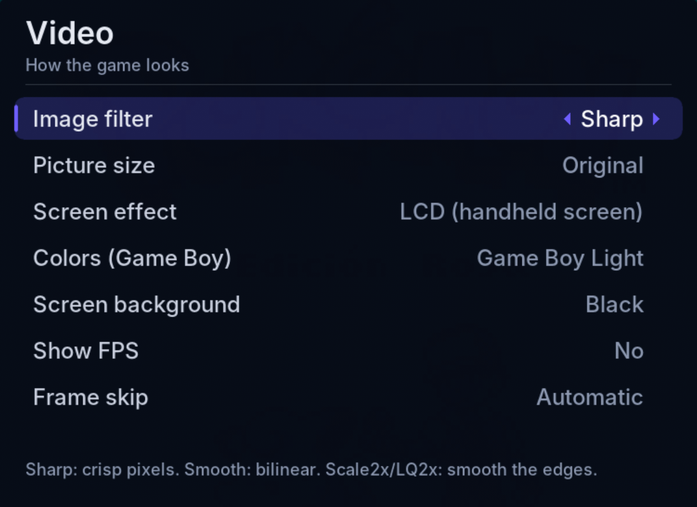

# vba360-enhanced-ai

🌐 **English** · [Español](README.md)

**Game Boy Advance, Game Boy and Game Boy Color emulator for Xbox 360** (homebrew; works with BadUpdate / RGH / JTAG), with **Super Game Boy borders**.

> 🆕 **New:** **Game Boy and Game Boy Color** games now run on the **Gambatte** core (Color-only games too, such as Pokémon Crystal), and Super Game Boy games can show **their border** and colors. Each game can have **its own picture settings** (Y button).
Fork of [frankischilling/vba360-enhanced](https://github.com/frankischilling/vba360-enhanced).

**[⬇️ Download the latest release](https://github.com/ZenithUzu/vba360-enhanced-ai/releases/latest)**

> 🤖 **Notice:** the changes in this fork were made with the help of artificial intelligence (Claude, by Anthropic). I maintain it as a **hobby**, non-commercial and with no warranty of any kind.

You are **free to use it or not**, and to copy, modify and share it under the GPL terms of the original project. All credit for the emulator and the port goes to their original authors (see the [original README](README.md#original-readme-vba360-enhanced)).

## Install

1. Download the `.zip` from the [latest release](https://github.com/ZenithUzu/vba360-enhanced-ai/releases/latest).
2. Copy the `VBA360` folder to your console (for example `Hdd1:\Emulators\VBA360\`) over FTP or USB.
3. Launch it from Aurora (`default.xex`). The other folders are created automatically.
4. Put your ROMs anywhere (hard drive or USB) and browse to them from the emulator.

## Features

**Interface**
- New interface, simple and fast, drawn by the emulator itself (the original XUI scenes are no longer used).
- **Games · Recent · Favorites · Settings** tabs (LB / RB).
- **Drive and folder** browser (hard drive, USB, memory units, emulator folder) with a preview of the last moment played and a marker when the ROM has a patch.
- **Search and sort** in the Games tab: **BACK** opens a keyboard to search by name: the list filters as you type and shows how many results there are, **START** (or the *Search* key) keeps the search, **B** cancels it and **BACK** erases what you typed (in the list, B clears the search), **START** changes the order (A-Z, Z-A or recently played) and **LT / RT** jump to the previous / next letter.
- **Box art:** when there is an image with the game's name, it is shown in the preview. See [Box art](#box-art).
- **Spanish and English**, with a help line on every option.
- **How an option is changed** (*Settings → Interface & language → Changing an option*): **side panel** (A opens the values on the right), **pop-up list** (in the middle) or **classic** (left / right). In the first two the change shows right away (filters, backgrounds, colors) **A** (or START) keeps it and **B** cancels it (back to the value it had). Two-value options (Yes / No, Off / On...), tilt sensitivity and the clock mode now open in the panel too; left / right still work in all three.
- **Color themes** (Default, Xbox 360, Game Boy, Game Boy Color, Game Boy Advance, Red and **Frutiger Aero**, with glossy glass-like buttons, translucent panels and a sky background with bubbles) and your own **background image** for the menu (*Settings → Interface & language*).

**In-game menu** (right stick click; can be changed in Controls)
- Save and load **states in 9 slots**, each with a thumbnail.
- **Fast forward** at 2x, 3x, 4x, 6x, 8x or maximum, holding or toggling the button.
- Cheats, game options, settings, screenshot, restart and quit.

**ROM hack and ROM compatibility**
- **Automatic BPS / UPS / IPS patching** up to 32 MB: the clean ROM is never modified.
- **Battery saves** (`.sav`) for GBA and GB: what you save inside the game is written when you quit, when you open the menu and periodically.
- The **save type** (Flash 64/128 KB, SRAM, EEPROM) and the **RTC clock** are detected **by reading the ROM**, not by the cartridge ID. Pokémon hacks save correctly even when they keep the original ID.
- **Per-game options** (Y button on a game, or *Game options* in the in-game menu), stored by file name: save type and clock (GBA), patch, **that game's picture**: *As in Settings* or *Custom* (filter, size, effect, Game Boy colors, **color correction** (GBA only), **frame blending**, **show FPS**, **frame skip** and, in Super Game Boy games, **Normal** or **Super Game Boy** mode) and **that game's buttons** (*As in Settings* or *Custom*, with its own *Set up buttons* screen). Settings still apply to every other game.
- Compressed ROMs in `.zip` and `.7z`.

**Game Boy and Game Boy Color** ([Gambatte](#game-boy-and-game-boy-color) core)
- **Game Boy** and **Game Boy Color** games (`.gb`, `.gbc`), with their colors, battery saves, clock (Pokémon Gold/Silver/Crystal) and rumble on the carts that have it.
- Game Boy games can use a fixed palette or the **automatic** one: the colors the Game Boy Color gave them.
- **Super Game Boy:** the **border** and colors each game had for the Super Game Boy (Pokémon Red/Blue/Yellow, Donkey Kong, Kirby...). See [Super Game Boy](#super-game-boy).
- **Kirby Tilt 'n' Tumble** (MBC7 cartridge, with a tilt sensor and its own save memory): tilt with the stick, like the GBA sensor games. See [Games with sensors](#games-with-sensors).

**Faster, more compatible GBA core** (improvements taken from [VBA-Next](https://github.com/libretro/vba-next))
- Backgrounds are drawn 8 pixels at a time instead of one by one, and rotation backgrounds that are not turning use a fast path. The picture is **identical** to before (compared frame by frame); background drawing takes about 60% fewer operations.
- The project builds with the Xbox 360 compiler speed options VBA-Next used.
- Fixes: the save memory also answers at its mirror address (0x0F000000) and with the byte repeated on 16/32-bit reads, as on the console; unaligned VRAM reads; multiply timing; Thumb rotate by 32. With these fixes the **Classic NES Series / Famicom Mini** games now start.

**Cheats**
- They are in **Game options** (Y button on a game, or *Options for this game* in the in-game menu) → **Cheats and codes**. The emulator knows whether the game is GBA or GB/GBC and offers the matching types:
  - **GBA:** Automatic, GameShark / Action Replay v1-v2, GameShark v3 / Action Replay v3, CodeBreaker and VBA (`address:value`).
  - **GB / GBC:** Automatic, **GameShark** (`01XXXXXX`) and **Game Genie** (`XXX-XXX-XXX` or `XXX-XXX`).
- Typed with an **on-screen keyboard** (then you can name them) or **imported** from `.cht` / `.txt` files (RetroArch format too).
- Each game keeps **its own list**, separated by console (`cheats\gba\` and `cheats\gb\`), even when the game isn't running; a GB code is never applied to a GBA game or the other way round. Lists from earlier versions are converted automatically the first time.

**Settings**
- **Video:** filter (sharp, smooth, Scale2x, LQ2x); original size (GBA 3:2, GB 10:9), full screen, **integer** (pixel perfect: GBA x4, GB x5) or **16:9** (fills the whole TV, stretched picture); **screen effect** (CRT-style scanlines or LCD-style grid); **Game Boy colors** (41 choices: gray, classic green, original Game Boy, Pocket, Light, the **32 official Super Game Boy palettes** 1-A to 4-H, sepia, blue, red and **automatic**, as on the Game Boy Color); **black or custom-image background** (centered, fill or stretch); **GBA color correction** (*Soft* or *Like the real screen*: tones down the loud colors games used to make up for the GBA's dark screen; math from Pokefan531's *gba-color* shader); **frame blending** (*Mix 2 frames* removes the flicker of sprites that blink every frame, as in Golden Sun or F-Zero; *LCD ghosting* imitates the original screen's trail); FPS counter and frame skip.
- **Audio:** sound, mute during fast forward, **volume** (25% to 200%) and **sound delay** (Normal 100 ms, Low 60 ms or Lowest 40 ms: less delay keeps the sound closer to the picture; if it crackles, go back to Normal).
- **Emulation:** fast forward speed and mode, optional real BIOS and format of 16-digit codes.
- **Saving:** save and state folders (next to the ROM or in the emulator folder), save state on exit, resume where you left off and **`.sav` backups**: when a game starts, a copy of its save goes to `saves\backups\` (the last 3: `-1` is the newest). If a hack or a cheat breaks the save, copy the backup over the `.sav`.
- **Controls:** every button can be remapped (also turbo A/B, fast forward, menu, quick save and quick load). Pick from the list or just press the new button.

## Screenshots

**Pokémon SoulGold (hack) with a border image and FPS counter:**

| | |
|---|---|
|  |  |

**Game Boy with screen effects and palettes** (*Pokémon Red*, Spanish edition):

| | |
|---|---|
|  |  |
| *No effect, Gray (original) palette* | *CRT, green palette* |
|  |  |
| *LCD, Game Boy Pocket palette* | *LCD, Game Boy Light palette* |

**Settings:**

| | |
|---|---|
|  |  |
|  |  |
|  |  |
|  |  |

## Playing a ROM hack

There are two ways:

**1. Pre-patched hack (`.gba`).** Open it like any other game. Hacks distributed as `.gba` files boot and save normally; for example, the **Pokémon SoulGold** in the screenshots is a GBA hack in this format. This is the recommended way, because it runs better.

**2. Clean ROM + patch.** Put the clean ROM and the patch in the same folder, with **the same name**:

```
Pokemon Unbound.gba
Pokemon Unbound.bps
```

When you open the ROM, the patch is applied automatically, in memory. Note: patched games may have performance drops (see [Known issues](#known-issues)); if that happens, use a pre-patched ROM.

## Screen background

By default the area around the game is **black**. To use an image, put it in the `borders\` folder next to `default.xex` (you can keep several, with any name) and pick it in **Settings → Video → Screen background**. Formats: **PNG, JPG, BMP, TGA and DDS** (not WebP). 1280×720 is ideal, but **Background fit** can keep it **Centered** (whole image in the middle), **Fill** the screen or **Stretch** it. The game is drawn on top, so only the sides show. There is an example in [`extras/borders/border.png`](extras/borders/border.png).

**Sizes for designing your own background** (a **1280×720** image, fit *Centered* or *Stretch*; for 1920×1080 multiply everything by 1.5). The game covers this rectangle:

| Console | Picture size | Game rectangle (x, y, width × height) | Free space at the sides |
|---|---|---|---|
| GBA | Original | 100, 0, 1080 × 720 | 100 px on each side |
| GBA | Integer | 160, 40, 960 × 640 | 160 px left/right, 40 px top/bottom |
| GB | Original / Integer | 240, 0, 800 × 720 | 240 px on each side |
| GBA and GB | Full screen | 80, 40, 1120 × 640 | 80 px left/right, 40 px top/bottom |
| GBA and GB | 16:9 | 0, 0, 1280 × 720 | none (the game covers the whole screen) |

If you use the same background for GBA and GB, keep the important artwork within the outer 100 px.

## Screen effects and colors

In **Settings → Video**:

- **Screen effect:**
  - **CRT (old TV):** scanlines that get thinner on bright colors plus a phosphor-grille mask. Adapted from the *zfast_crt* shader by Greg Hogan (GPL v2+), taken from [libretro/glsl-shaders → `crt/shaders/zfast_crt.glsl`](https://github.com/libretro/glsl-shaders/blob/master/crt/shaders/zfast_crt.glsl).
  - **LCD (handheld screen):** a fine grid and red/green/blue sub-pixels, like a handheld's screen. Adapted from the *lcd3x* shader by Gigaherz (public domain), taken from [libretro/glsl-shaders → `handheld/shaders/lcd3x.glsl`](https://github.com/libretro/glsl-shaders/blob/master/handheld/shaders/lcd3x.glsl).
  - Both were translated from GLSL (RetroArch) to HLSL for the Xbox 360 and work for GBA and GB. They look best with **Picture size → Integer**.
- **Colors (Game Boy):** 41 choices for Game Boy games (Game Boy Color games always keep their own colors). **Automatic** gives each game the colors the Game Boy Color picked for it at boot (or the Super Game Boy ones when those are more colorful); games not on that list are shown in gray. The original Game Boy (DMG), Pocket, Light and the **32 Super Game Boy** presets (1-A to 4-H) come from RetroArch's Gambatte core: [libretro/gambatte-libretro → `libgambatte/libretro/gbcpalettes.h`](https://github.com/libretro/gambatte-libretro/blob/master/libgambatte/libretro/gbcpalettes.h) (Sindre Aamås, GPL v2). Plus Gray (original), Classic green and the extras Sepia, Blue and Red.

## Games with sensors

Some GBA cartridges (and one Game Boy Color one) carried extra hardware. The emulator recognizes them by their game code and imitates it with the controller:

| Game | Cartridge hardware | How to use it on the Xbox |
|---|---|---|
| *Boktai 1 and 2*, *Shin Bokura no Taiyou* | Solar light sensor + clock | **Right stick up = more sun, down = less** (0 to 10, shown on screen). Level 10 fills every bar |
| *WarioWare: Twisted!* | Gyroscope + rumble | Rotate = **right stick** left or right; rumble goes to the controller |
| *Drill Dozer* | Rumble | Rumble goes to the controller |
| *Yoshi Topsy-Turvy*, *Koro Koro Puzzle* | Tilt sensor | Tilt = **right stick** |
| *Kirby Tilt 'n' Tumble* (GBC) | Accelerometer + EEPROM memory (MBC7) | Tilt = **right stick**; the game saves to the `.sav` (256 bytes) |

In **Settings → Controls**, below the buttons, there is a **Motion sensors** section. Each movement is mapped to a stick direction, just like the buttons:

| Movement | Default |
|---|---|
| Tilt right | Right stick → right |
| Tilt left | Right stick → left |
| Tilt up | Right stick → up |
| Tilt down | Right stick → down |
| More sunlight (Boktai) | Right stick → up |
| Less sunlight (Boktai) | Right stick → down |

- WarioWare: Twisted!'s **rotation** uses the same directions as tilt left / right.
- To change one: select it, press **A** and push **either stick** the way you want. You can also pick from the list with left/right, or leave it unassigned with **X**. **START** resets everything.
- **Tilt sensitivity** (50% to 200%).

Sensors **only work in the games that have them**, so they never interfere with anything else. If you map a sensor to the left stick, in that game the left stick stops moving the D-pad so they don't clash.

The solar sensor, gyroscope and rumble were adapted from current VisualBoyAdvance-M ([`src/core/gba/gbaRtc.cpp`](https://github.com/visualboyadvance-m/visualboyadvance-m/blob/master/src/core/gba/gbaRtc.cpp), GPL v2+). The sun scale was extended beyond VBA-M's (whose maximum only showed 6 of Boktai's 8 bars).

## Game clock

GBA games with a clock (Pokémon Ruby/Sapphire/Emerald, Boktai...) use the console time. **Settings → Game clock → Custom** lets you pick another year, month, day, hour and minute; from there the clock keeps running. *Back to the console time* undoes it.

## Game Boy and Game Boy Color

Game Boy and Game Boy Color games run on **Gambatte**, a very accurate core by Sindre Aamås, taken from [libretro/gambatte-libretro](https://github.com/libretro/gambatte-libretro) (GPL v2), the one RetroArch uses. That is why **Game Boy Color-only** games (Pokémon Crystal, Super Mario Bros. Deluxe, Zelda: Oracle of Seasons...) and modern homebrew work.

- **Colors:** Game Boy Color games look like they did on its screen (Gambatte's "accurate" color correction). Game Boy games use the palette in *Settings → Video → Colors (Game Boy)*.
- **Saves:** the `.sav` is the cartridge memory as is, so saves from other emulators work. On carts with a clock (Pokémon Gold/Silver/Crystal) the clock is stored at the end of the same file. **Save states** made with earlier versions of the emulator don't load for Game Boy games.
- **Cheats:** GameShark (`01XXXXXX`) and Game Genie (`XXX-XXX-XXX`).
- **BIOS (optional):** with *Real BIOS* on, `bios\gb_bios.bin` (256 bytes) and `bios\gbc_bios.bin` (2304 bytes) show the boot logo. Without them games start directly.
- *Kirby Tilt 'n' Tumble* (MBC7 cart with a tilt sensor) now works: tilt it with the right stick. The *Game Boy Camera* and Bandai's *TAMA5* cart (Tamagotchi) still don't work.

## Super Game Boy

In **Settings → Video → Super Game Boy (borders)**:

| Option | What it does |
|---|---|
| **Off** (default) | Game Boy games use the palette chosen in *Colors (Game Boy)* |
| **Game Boy games** | Games made for the Super Game Boy show **their border** and their per-area colors, as on the Super Nintendo |
| **Also Color-compatible ones** | The same, and games that are also Game Boy Color games (Pokémon Yellow, Gold/Silver, Zelda DX...) run in Super Game Boy mode instead of in color |

It can also be set **per game**: Y button → *This game's picture: Custom* → *Game mode: Normal / Super Game Boy* (only shown in games with Super Game Boy features).

- It applies **when the game starts** (the picture becomes 256×224 with the border).
- The game itself sends its border when it boots; until then, or in games without one, the frame is black. The console's generic Super Game Boy border is not included.
- Save states include the border and the colors.
- Adapted from [SameBoy](https://github.com/LIJI32/SameBoy) (`Core/sgb.c`, by Lior Halphon, MIT license).

## Box art

Put a game's cover in the `covers\` folder next to `default.xex`, with **the same name as the ROM** and a `.png` or `.jpg` extension. For example, for `Pokemon Emerald.gba` use `covers\Pokemon Emerald.png`. An image next to the ROM with the same name (`Pokemon Emerald.png`) works too.

The cover is shown in the preview to the right of the list, keeping its proportions. Games without a cover show the thumbnail of the last session as before. About 400×400 pixels is enough; bigger images work too but take a little longer to load.

## Menu: themes and background image

In **Settings → Interface & language**:

- **Color theme:** Default (purple), Xbox 360 (green), Game Boy (olive green), Game Boy Color (berry), Game Boy Advance (indigo), Red and **Frutiger Aero** (sky and water blue, a green glow, bubbles; selections are glossy pills with a shine and panels look like frosted glass, in the style of Windows Vista / 7 and the Xbox 360 of that era). Text stays light on dark in all of them.
- **Background image:** put images (PNG, JPG, BMP, TGA or DDS; 1280×720 is best) in the `backgrounds\` folder next to `default.xex` and pick one. It is darkened with the theme's colors so the text stays readable.

## Folders the emulator creates

Next to `default.xex`: `saves\`, `states\`, `cheats\`, `screenshots\`, `thumbs\`, `config\`, `borders\`, `backgrounds\`, `covers\` (box art), `saves\backups\` (save copies) and `bios\` (put `gba_bios.bin`, `gb_bios.bin` or `gbc_bios.bin` there if you want to use the real BIOS). Settings are stored in `vba360.ini`.

The **`vba360.log`** file (next to `default.xex`) records what happens in each session: the game opened, the core used, saves and errors. If something fails, send it along with your report.

## Limitations

- **Super Game Boy:** the console's generic border, the boot animation and jingle, and the extra sound a few games used are not included.
- **Game Boy Color (new):** Gambatte support is recent; if a game fails, please open an *issue*.
- **Classic NES Series / Famicom Mini** (the NES games for GBA, such as *Super Mario Bros.* or *Zelda*): **they now start**, thanks to the memory fixes taken from VBA-Next.
- **Not emulated (yet):**
  - **Link cable** and **wireless adapter** (multiplayer and trading), on GBA and on GB/GBC.
  - **e-Reader** and its cards, **Game Boy Camera**, **Game Boy Printer** and the Game Boy Color's **infrared**.
  - Bandai's **TAMA5** Game Boy cartridge (Tamagotchi).

## Known issues

- ~~**Colored lines / the menu around the game**~~ **(fixed):** with the black background or a screen effect on, colored lines or the menu could sometimes show at the sides of the game. The emulator now paints the whole background black every frame and clears the game picture when it starts. If it ever happens again, a **background image** avoids it (Settings → Video → Screen background).

- **Performance with patches:** games loaded with a **UPS / IPS / BPS** patch applied on the fly can have FPS drops. Pre-patched `.gba` hacks don't have this problem.

## Status

Tested on console (BadUpdate + Aurora). Work in progress: if you find bugs, please open an *issue*.

## Credits

- **Original emulator authors:** Forgotten (VisualBoyAdvance) and the **VBA-M team**, plus the **VBA-GX** team, whose code the port uses.
- **Original Xbox 360 port:** the authors of **VBA360** and the **libSDLx360** library, with support from **Team Avalaunch** and **Team XeLove**.
- **vba360-enhanced fork:** [**frankischilling**](https://github.com/frankischilling), who fixed the port's build and whose work this project is based on.
- **This fork (vba360-enhanced-ai):** [**ZenithUzu** (ZenithARC)](https://github.com/ZenithUzu). Idea, console testing, builds and screenshots.
- **AI programming:** **Claude** (by [Anthropic](https://www.anthropic.com)). Wrote the code changes and documentation of this fork.
- **Interface font:** [Inter](https://rsms.me/inter/) by Rasmus Andersson (SIL OFL license).
- **Screen effects:** adapted from [libretro/glsl-shaders](https://github.com/libretro/glsl-shaders): *zfast_crt* by Greg Hogan (GPL v2+) for CRT and *lcd3x* by Gigaherz (public domain) for LCD.
- **Game Boy and Game Boy Color core:** [Gambatte](https://github.com/libretro/gambatte-libretro), by **Sindre Aamås** and the gambatte-libretro contributors (libretro), GPL v2. Details of the version used in [`src/gambatte/README-VBA360.txt`](vba360-enhanced/src/gambatte/README-VBA360.txt).
- **Super Game Boy and MBC7 cartridges:** borders, colors, accelerometer and EEPROM adapted from [SameBoy](https://github.com/LIJI32/SameBoy), by **Lior Halphon** (MIT license).
- **GBA core improvements:** tiled drawing, fast path for rotation backgrounds, compiler options and the memory fixes that make Classic NES Series start, taken from [VBA-Next](https://github.com/libretro/vba-next) (libretro, maintained by **Squarepusher / twinaphex**, GPL v2).
- **GBA color correction:** math from **Pokefan531**'s *gba-color* shader (libretro).
- **Core tests:** [gba-tests](https://github.com/jsmolka/gba-tests) by **jsmolka**, **Blargg**'s *cpu_instrs* and [dmg-acid2 / cgb-acid2](https://github.com/mattcurrie/dmg-acid2) by **Matt Currie**, used to check that the changes don't break anything.
- **Game Boy palettes:** from the same Gambatte core: original Game Boy, Pocket, Light, the 32 Super Game Boy presets and the Game Boy Color's automatic palettes.
- **Cartridge sensors** (sun, gyroscope, rumble): adapted from [current VisualBoyAdvance-M](https://github.com/visualboyadvance-m/visualboyadvance-m) (GPL v2+).
- **Game Boy sound and archive reading:** Gb_Apu, Blip_Buffer and File_Extractor by Shay Green (blargg).

The full list of credits and libraries is in the [original README](README.md#original-readme-vba360-enhanced).

## License

This program is free software under the **GNU General Public License v2 or later**, distributed WITHOUT ANY WARRANTY. Users are responsible for having the legal right to use any ROM with this emulator. Not affiliated with Nintendo or Microsoft.
