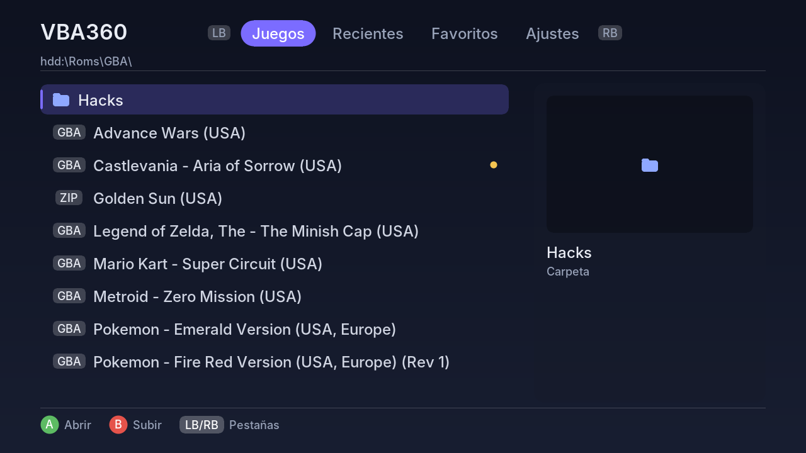
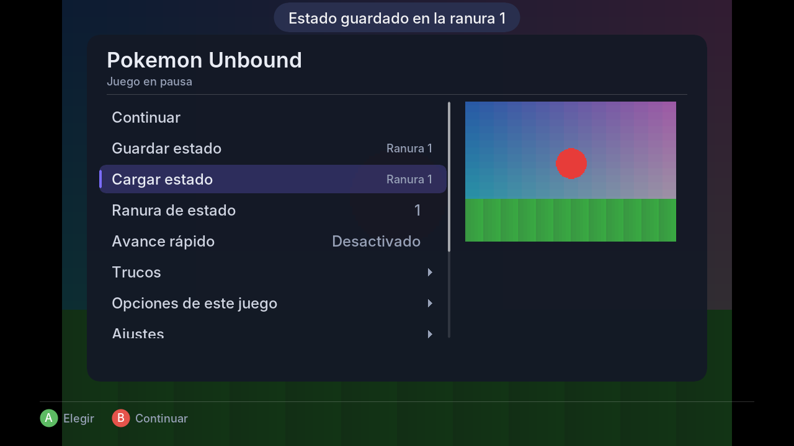
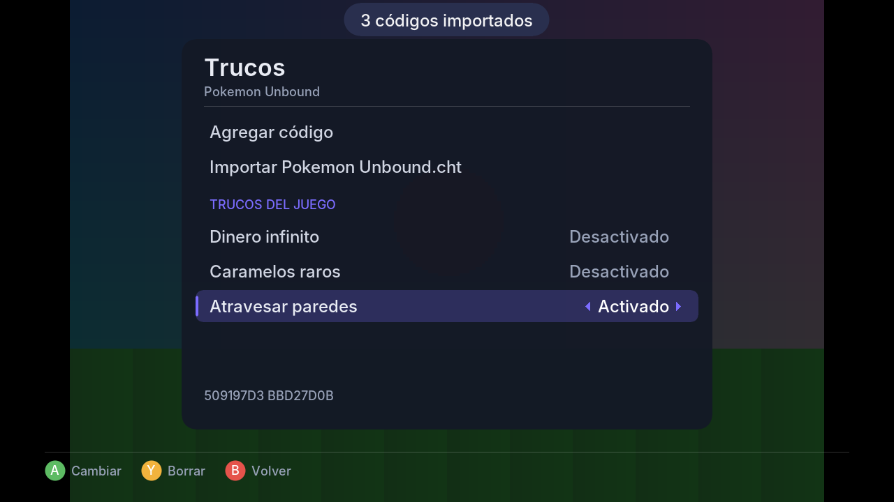

# vba360-enhanced-ai

Fork de / Fork of [frankischilling/vba360-enhanced](https://github.com/frankischilling/vba360-enhanced).

## 🇲🇽 Español

> 🤖 **Aviso:** los cambios de este fork fueron hechos con ayuda de inteligencia artificial (Claude, de Anthropic). Lo mantengo por **pasatiempo**, sin fines de lucro y sin ninguna garantía.

Eres **libre de usarlo o no**, de copiarlo, modificarlo y compartirlo, bajo los términos de la licencia GPL del proyecto original. Todo el crédito del emulador y del port es de sus autores originales (ver más abajo).



### Qué trae este fork

**Interfaz nueva**, simple y rápida, dibujada por el propio emulador (ya no usa las escenas XUI):
- Pestañas **Juegos · Recientes · Favoritos · Ajustes** (cambias con LB/RB).
- Explorador de **unidades y carpetas** (disco duro, USB, carpeta del emulador), con vista previa del juego y aviso si tiene parche.
- Todo en **español o inglés**, con una línea de ayuda en cada opción.

**Menú dentro del juego** (clic del stick derecho, o BACK + START):
- Guardar y cargar estado en **9 ranuras con miniatura**.
- **Avance rápido** (2x, 3x, 4x, 6x, 8x o máximo; mantener o alternar).
- **Trucos**, opciones del juego, ajustes, captura de pantalla, reiniciar y salir.



**Trucos:** GameShark, Action Replay, CodeBreaker y códigos VBA para GBA; GameShark y Game Genie para GB/GBC. Se escriben con un teclado en pantalla o se importan de un archivo `.cht` / `.txt` (también el formato de RetroArch). Se guardan por juego.

**Controles configurables:** cada botón del GBA, turbo A/B, avance rápido, menú, guardado y carga rápida. Puedes elegir de la lista o simplemente presionar el botón nuevo.

**Ajustes:** filtro (nítido, suave, Scale2x, LQ2x), tamaño original o pantalla completa, FPS, salto de cuadros, sonido, BIOS original opcional, carpetas de partidas y estados, guardar estado al salir y continuar donde lo dejaste.

**Compatibilidad sin depender del ID del juego:**
- El tipo de guardado (Flash 64/128 KB, SRAM, EEPROM) y el reloj RTC se detectan **leyendo la ROM**, no por el código del cartucho. Así funcionan los hacks aunque conserven el ID del juego original.
- **Opciones por juego** (botón Y sobre un juego) guardadas por **nombre de archivo**: tipo de guardado, RTC y parche.
- **Parches BPS / UPS / IPS automáticos** para GBA y también para GB/GBC, hasta 32 MB.

### Cómo usar un hack

Pon la ROM limpia y el parche en la misma carpeta, con **el mismo nombre**:

```
Pokemon Unbound.gba
Pokemon Unbound.bps
```

Al abrir la ROM, el parche se aplica solo, en memoria (tu archivo no cambia).

### Carpetas que crea el emulador

Junto a `default.xex`: `saves\`, `states\`, `cheats\`, `screenshots\`, `thumbs\`, `config\` y `bios\` (pon ahí `gba_bios.bin` si quieres usar la BIOS original). La configuración se guarda en `vba360.ini`.

### Estado

La interfaz, los parches, la detección de guardado y los trucos están probados en PC. **Pendiente de probar en una Xbox 360 real** (BadUpdate + Aurora). Para compilar: ver *Building* más abajo (ya no hace falta empaquetar el skin XUI).

## 🇺🇸 English

> 🤖 **Notice:** the changes in this fork were made with the help of AI (Claude, by Anthropic). I maintain it as a **hobby**, non-commercial and with no warranty of any kind.

You are **free to use it or not**, and to copy, modify and share it under the GPL terms of the original project. All credit for the emulator and the port goes to their original authors (see below).

### What this fork adds

- **New interface** drawn by the emulator itself (no more XUI scenes): Games · Recent · Favorites · Settings tabs, a drive and folder browser with game previews, Spanish or English.
- **In-game menu** (right stick click, or BACK + START): 9 save-state slots with thumbnails, fast forward (2x–8x or maximum, hold or toggle), cheats, game options, settings, screenshots, restart and quit.
- **Cheats:** GameShark, Action Replay, CodeBreaker and VBA codes for GBA; GameShark and Game Genie for GB/GBC. Type them with an on-screen keyboard or import a `.cht` / `.txt` list (RetroArch format too). Saved per game.
- **Remappable controls**, including turbo, fast forward, menu and quick save/load.
- **Settings:** filters (sharp, smooth, Scale2x, LQ2x), original or full-screen picture, FPS, frame skip, sound, optional real BIOS, save/state folders, save on exit and resume.
- **Compatibility that does not rely on the game ID:** save type and RTC are detected by reading the ROM; per-game options are keyed by file name; BPS/UPS/IPS patches are applied automatically for GBA and GB/GBC, up to 32 MB.



### How to use a hack

Put the clean ROM and the patch in the same folder with **the same name** (`Pokemon Unbound.gba` + `Pokemon Unbound.bps`). The patch is applied in memory when the ROM is opened.

### Status

Interface, patching, save detection and cheats are tested on PC. **Not yet tested on real Xbox 360 hardware** (BadUpdate + Aurora). To build it, see *Building* below (the XUI skin no longer needs packaging).

---

# Original README (vba360-enhanced)

An enhanced Xbox 360 port of VisualBoyAdvance-M (VBA-M), a Game Boy and Game Boy Advance emulator.

> **Note:** This can also be built with newer versions of Visual Studio and the Xbox 360 SDK/XDK. If you want to update from Visual Studio 2008, try using Visual Studio 2010. Confirmed working on Xbox 360 SDK 21256.3.

## ⚠️ Work in Progress

**IMPORTANT:** This project is currently a **work in progress** focused solely on fixing build issues and getting the source code to compile and run on Xbox 360. **No new features are being added at this time.** The goal is to restore functionality and ensure the existing codebase builds successfully.

## About

vba360-enhanced is based on VisualBoyAdvance-M (VBA-M), ported to the Xbox 360 platform. This project aims to provide a functional Game Boy and Game Boy Advance emulator for Xbox 360 users.

### Background of VBA

In 2004, Forgotten created the original VisualBoyAdvance (VBA) emulator. At the time, VBA was being released through vba.ngemu.com. Following the initial release, the project was handed over to the VBA team.

Development of the original VBA ceased in 2004 with the release of 1.8 beta 3. However, the project continued through various developers aiming to improve VBA but not united in their efforts to do so. These "forked" versions improved on the original VBA but needed focus and unity to capture all the different improvements being accomplished.

### The Rise of VBA-M

In an effort to bring some cohesion to the multiplicity of releases, a version named VBA-M was created. VBA-M is now in active development, with updates as current as November 2009.

In addition to the DirectX version for the Windows platform, there is also one based on SDL, the free, platform-independent, graphics library. VBA is available for a variety of operating systems, such as Linux, BSD, Mac OS X, Xbox, and BeOS. VisualBoyAdvance has also been ported to GameCube and Wii.

### About VBA360

Visual Boy Advance 360 (VBA360) is an Xbox 360 port of VBA-M. This enhanced version (vba360-enhanced) is based on that work, with a focus on fixing build issues and ensuring the codebase compiles and runs correctly on Xbox 360.

Some code parts of VBA-GX are used in VBA360. Credit to the VBA-GX coders for their hard work.

VBA360 uses libSDLx360 (SDL libraries for the Xbox 360), which is included in this project.

## Features

- Game Boy Advance / Game Boy / Game Boy Color / Super Game Boy emulation
- Graphics / Sound / Controller support
- Savestate and Battery save support
- Enhanced Graphics Filter support
- Bilinear / Point hardware filtering
- Compressed ROM Support (.zip, .7z)
- Favorites Support
- Supports 64k/128k Flash Saves
- Turbo support (Right Trigger)
- In-game menu activation via right thumbstick

**Note:** These features are from the original VBA360 port. This enhanced version focuses on fixing build issues to ensure these features work correctly.

## Credits

### Original Developers

- **Forgotten** (1999-2003) - Original VisualBoyAdvance developer
- **VBA Development Team** (2004-2006) - VisualBoyAdvance-M development team
- **VBA-GX Team** - Code parts from VBA-GX are used in VBA360
- **VBA360 Original Port** - Xbox 360 port of VBA-M
- **Team Avalaunch** - Xbox development tools and support
- **Team XeLove** - Xbox development community support

### Third-Party Libraries

This project uses the following open-source libraries:

- **SDL (Simple DirectMedia Layer)** - Cross-platform multimedia library
  - Ported to Xbox 360 as libSDLx360 (also referred to as libSDL360x)
  - Copyright (C) 1997-2002 Sam Lantinga
  - Source code available separately at: https://github.com/frankischilling/libSDLx360

- **libpng** - PNG image format library
  - Version 1.4.0
  - Copyright (C) 1998-2002, 2004, 2006-2010 Glenn Randers-Pehrson

- **zlib** - Compression library
  - Copyright (C) 1995-2010 Jean-loup Gailly and Mark Adler

- **File_Extractor** - Archive extraction library
  - Version 1.0.0
  - Author: Shay Green <gblargg@gmail.com>
  - License: GNU LGPL 2.1 or later

- **SDL_ttf** - TrueType font rendering for SDL
  - Ported to Xbox 360 as SDL_ttf360

## License

This program is free software; you can redistribute it and/or modify it under the terms of the GNU General Public License as published by the Free Software Foundation; either version 2, or (at your option) any later version.

This program is distributed in the hope that it will be useful, but WITHOUT ANY WARRANTY; without even the implied warranty of MERCHANTABILITY or FITNESS FOR A PARTICULAR PURPOSE. See the GNU General Public License for more details.

You should have received a copy of the GNU General Public License along with this program; if not, write to the Free Software Foundation, Inc., 59 Temple Place - Suite 330, Boston, MA 02111-1307, USA.

## Building

### Requirements

- Microsoft Visual Studio 2008 (or compatible)
- Xbox 360 SDK
- Xbox 360 development kit or compatible environment

### Build Instructions

1. Open `vbam.sln` in Visual Studio
2. Ensure all dependencies are properly configured:
   - `libSDLx360` must be built first
   - `File_Extractor` library must be available
3. Select the desired configuration (Debug, Release, or Release_LTCG)
4. Build the solution

### Project Structure

- `src/` - Main source code
- `libSDLx360/` - SDL library port for Xbox 360
- `SDL_ttf360/` - SDL_ttf library port for Xbox 360
- `dependencies/` - Third-party dependencies
- `Skin/` - Xbox 360 UI skin files

### Technical Notes

**emucrc32.c Implementation:**

This project uses `emucrc32.c`, a portable CRC32 wrapper originally developed for [snes360-enhanced](https://github.com/frankischilling/snes360-enhanced). This file provides a flexible CRC32 implementation that can work with or without zlib:

- When `HAVE_ZLIB` is defined, it uses zlib's `crc32()` function
- When `EMUCRC32_STANDALONE` is defined, it uses a self-contained CRC32 implementation
- Provides compatibility functions (`emu_crc32()`, `calc_crc32()`) expected by older emulator codebases
- Also provides `crc32()` wrapper for unzip code compatibility

This shared implementation ensures consistent CRC32 handling across both snes360-enhanced and vba360-enhanced projects.

## Current Status

✅ **Build Status: The project now builds and runs successfully on Xbox 360!**

This project has completed the initial phase of fixing compilation and build issues. The codebase now compiles without errors and runs on Xbox 360 hardware. Recent fixes include:

- Fixed zlib compilation errors (added `HAVE_ZLIB` preprocessor definition)
- Fixed SDL header include issues
- Fixed PNG I/O for Xbox 360 HANDLE-based file operations
- Fixed library linking paths
- Added missing zlib source files (`crc32.c`, `explode.c`, `unreduce.c`, `unshrink.c`)
- Added stub implementation for `SDL_AppActiveInit`
- Created Xbox 360 image configuration file (`xex.xml`)
- Uses `emucrc32.c` - A portable CRC32 wrapper originally developed for [snes360-enhanced](https://github.com/frankischilling/snes360-enhanced) and now shared across both projects

**Next Steps:** With the build issues resolved, the next phase will focus on adding new features and improvements to enhance the emulator's functionality and user experience.

## Known Issues

- This is a work in progress - functionality may be incomplete or unstable
- Some features may not work as expected
- Performance may vary depending on the Xbox 360 hardware configuration

## Disclaimer

This software is provided for educational and research purposes. Users are responsible for ensuring they have the legal right to use any ROM files with this emulator. The developers do not condone piracy or copyright infringement.

## Background and Notes

The Xbox 360 scene already has a port of XeBoyAdvance, which is a top class emulator. Props to LoveMHZ for his hard work and efforts, especially considering it was developed on a retail kit.

Visual Boy Advance 360 started out as a simple proof of concept project. The original VBA360 port was developed as a learning project to understand PPC architecture and optimization techniques for the Xbox 360 platform.

This enhanced version (vba360-enhanced) continues that work by focusing on fixing build issues and ensuring the codebase compiles and runs correctly. The source code has been provided in the interests of the scene and GPL compliance.

**Note:** The codebase may contain some "quick and dirty" hacks and optimizations from the original proof of concept. You have been warned.

## Acknowledgments

Special thanks to:
- The original VisualBoyAdvance and VBA-M development teams
- The VBA-GX development team
- The original VBA360 port developers
- LoveMHZ for XeBoyAdvance (an excellent alternative Xbox 360 GBA emulator)
- All contributors to the open-source libraries used in this project
- The Xbox 360 homebrew development community

---
**Note:** This project is not affiliated with, endorsed by, or associated with Nintendo, Microsoft, or any other company. Game Boy and Game Boy Advance are trademarks of Nintendo Co., Ltd., or associated with Nintendo, Microsoft, or any other company. Game Boy and Game Boy Advance are trademarks of Nintendo Co., Ltd.
