# vba360-enhanced-ai

🌐 [English](README.en.md) · **Español**

Emulador de **Game Boy Advance y Game Boy para Xbox 360** (homebrew, funciona con BadUpdate / RGH / JTAG).
Fork de [frankischilling/vba360-enhanced](https://github.com/frankischilling/vba360-enhanced).

**[⬇️ Descargar la última versión](https://github.com/axelconde7w7-gif/vba360-enhanced-ai/releases/latest)**

> 🤖 **Aviso:** los cambios de este fork fueron hechos con ayuda de inteligencia artificial (Claude, de Anthropic). Lo mantengo por **pasatiempo**, sin fines de lucro y sin ninguna garantía.

Eres **libre de usarlo o no**, de copiarlo, modificarlo y compartirlo, bajo los términos de la licencia GPL del proyecto original. Todo el crédito del emulador y del port es de sus autores originales (ver más abajo).

## Instalación

1. Descarga el `.zip` de la [última versión](https://github.com/axelconde7w7-gif/vba360-enhanced-ai/releases/latest).
2. Copia la carpeta `VBA360` a tu consola (por ejemplo `Hdd1:\Emulators\VBA360\`) por FTP o USB.
3. Ábrela desde Aurora (`default.xex`). Las demás carpetas se crean solas.
4. Pon tus ROMs donde quieras (disco duro o USB) y búscalas desde el explorador del emulador.

## Funciones

**Interfaz**
- Interfaz propia, simple y rápida, dibujada por el emulador (ya no usa las escenas XUI originales).
- Pestañas **Juegos · Recientes · Favoritos · Ajustes** (LB / RB).
- Explorador de **unidades y carpetas** (disco duro, USB, unidades de memoria, carpeta del emulador) con vista previa del último momento jugado y aviso si la ROM tiene parche.
- **Español e inglés**, con una línea de ayuda en cada opción.

**Menú dentro del juego** (clic del stick derecho; se puede cambiar en Controles)
- Guardar y cargar **estados en 9 ranuras**, cada una con miniatura.
- **Avance rápido** de 2x, 3x, 4x, 6x, 8x o máximo, manteniendo o alternando el botón.
- Trucos, opciones del juego, ajustes, captura de pantalla, reiniciar y salir.

**Compatibilidad con hacks y ROMs**
- **Parches BPS / UPS / IPS automáticos** hasta 32 MB: la ROM limpia no se modifica.
- **Guardado de batería** (`.sav`) en GBA y GB: lo que guardas dentro del juego se escribe al salir, al abrir el menú y periódicamente.
- El **tipo de guardado** (Flash 64/128 KB, SRAM, EEPROM) y el **reloj RTC** se detectan **leyendo la ROM**, no por el ID del cartucho. Así guardan bien los hacks de Pokémon aunque conserven el ID original.
- **Opciones por juego** (botón Y sobre un juego), guardadas por nombre de archivo: tipo de guardado, reloj y parche.
- ROMs comprimidas en `.zip` y `.7z`.

**Trucos**
- GameShark, Action Replay, CodeBreaker y códigos VBA.
- Se escriben con un **teclado en pantalla** o se **importan** de archivos `.cht` / `.txt` (también el formato de RetroArch). Se guardan por juego.

**Ajustes**
- **Video:** filtro (nítido, suave, Scale2x, LQ2x); tamaño original (GBA 3:2, GB 10:9), pantalla completa, **entero** (píxel exacto: GBA x4, GB x5) o **16:9** (llena toda la TV, imagen estirada); **efecto de pantalla** (líneas tipo CRT o rejilla tipo LCD); **colores de Game Boy** (40 paletas: gris, verde clásico, Game Boy original, Pocket, Light, las **32 paletas oficiales de Super Game Boy** de la 1-A a la 4-H, y sepia, azul y rojo); **fondo negro o con imagen propia** (centrada, rellenar o estirar); mostrar FPS y salto de cuadros.
- **Audio:** sonido y silenciar durante el avance rápido.
- **Emulación:** velocidad y modo del avance rápido, BIOS original opcional y formato de los códigos de 16 dígitos.
- **Guardado:** carpeta de partidas y de estados (junto a la ROM o en la carpeta del emulador), guardar estado al salir y continuar donde lo dejaste.
- **Controles:** todos los botones reasignables (también turbo A/B, avance rápido, menú, guardado y carga rápida). Puedes elegir de la lista o simplemente presionar el botón nuevo.

## Capturas

**Pokémon SoulGold (hack) con imagen de borde y contador de FPS:**

| | |
|---|---|
| 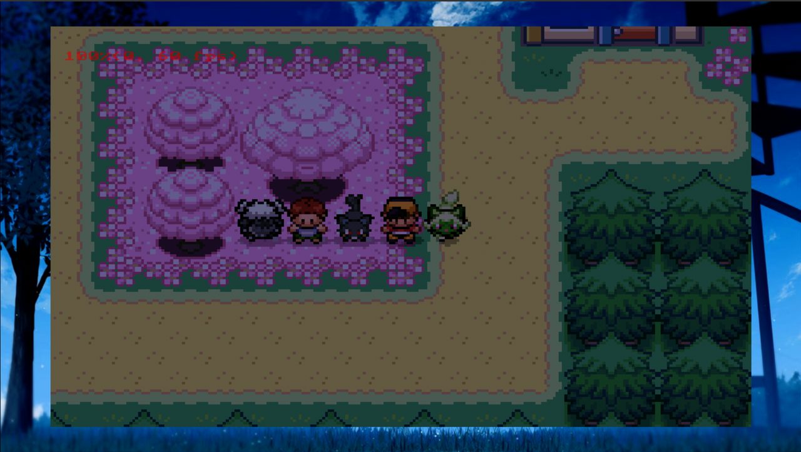 | 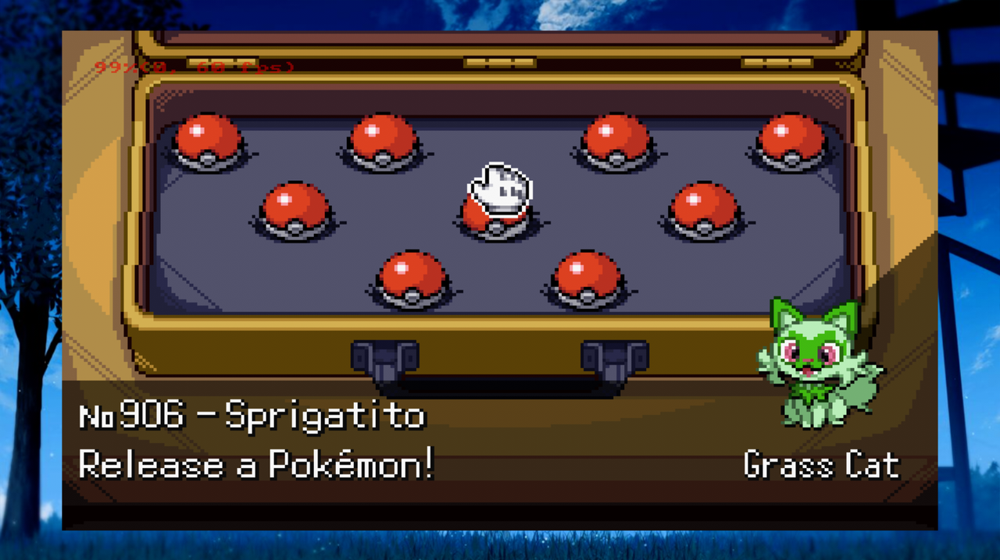 |

**Game Boy con efectos de pantalla y paletas** (*Pokémon Edición Roja*):

| | |
|---|---|
| 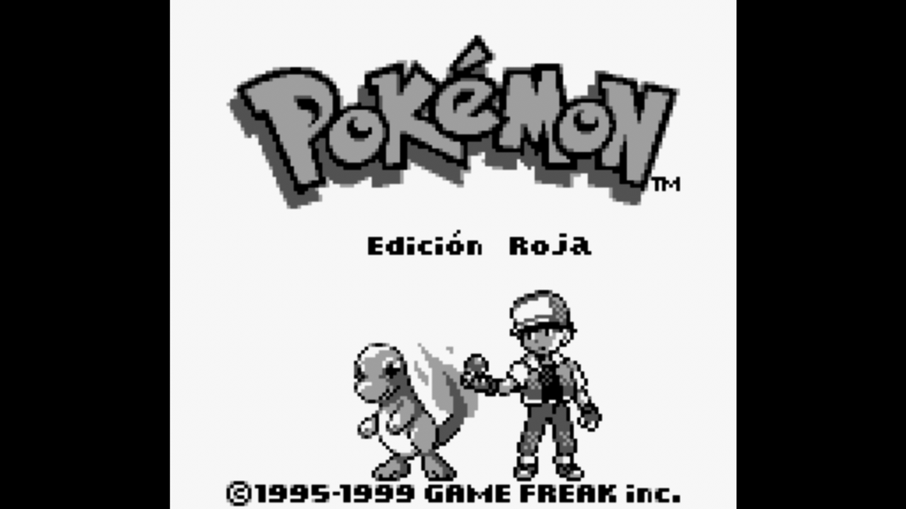 | 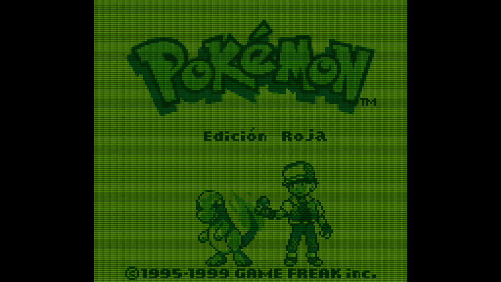 |
| *Sin efecto, paleta Gris (original)* | *CRT, paleta verde* |
| 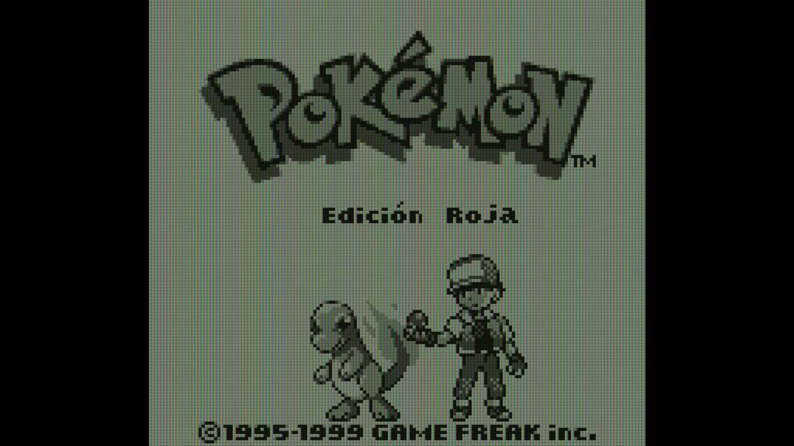 | 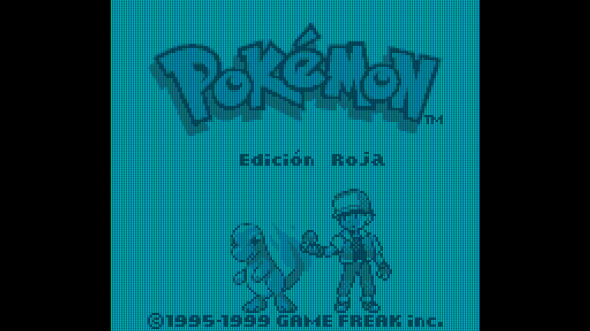 |
| *LCD, paleta Game Boy Pocket* | *LCD, paleta Game Boy Light* |

**Ajustes:**

| | |
|---|---|
| 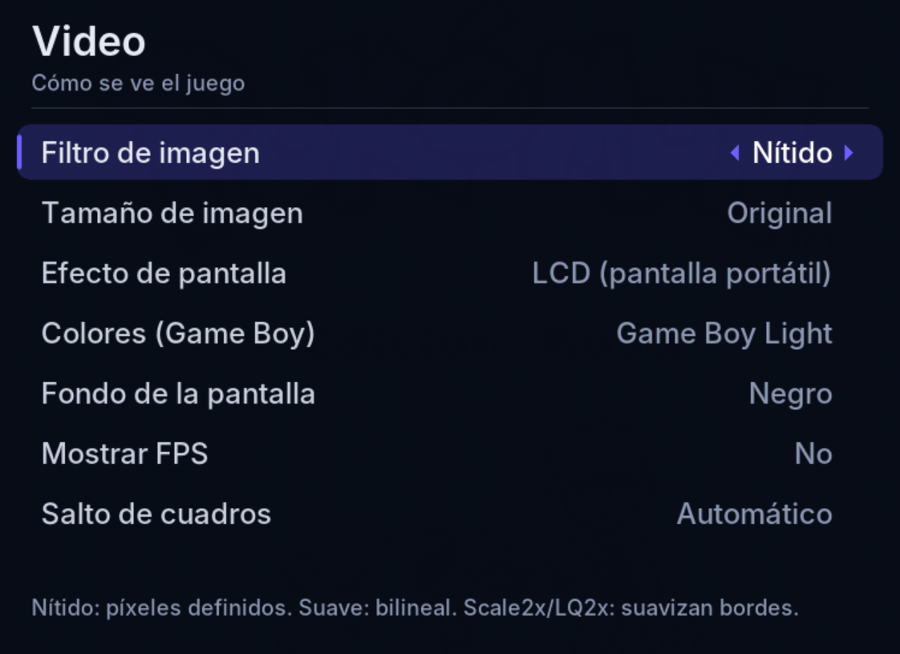 | 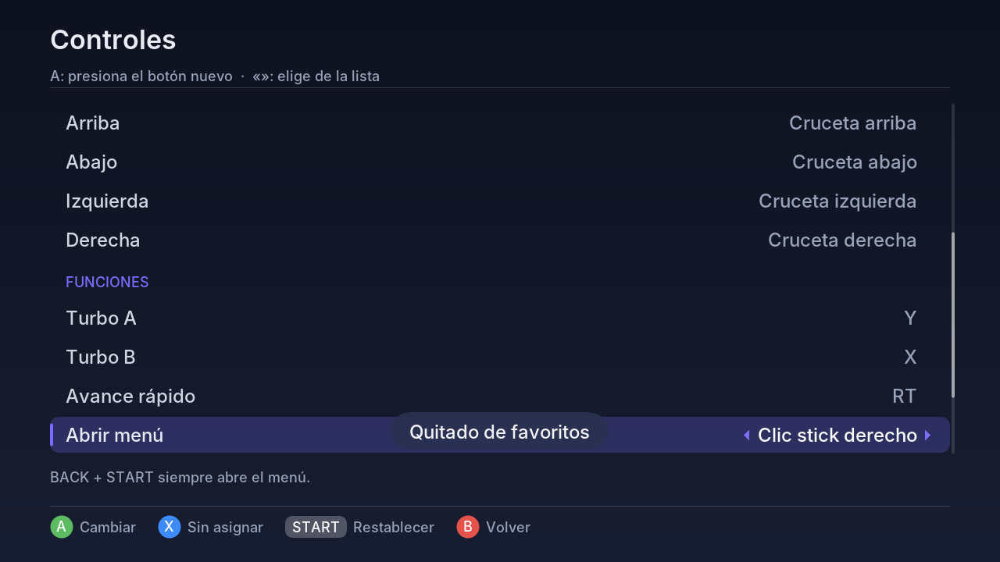 |
| 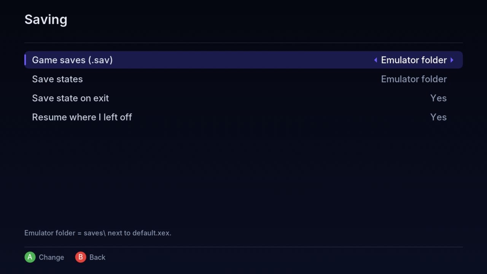 | 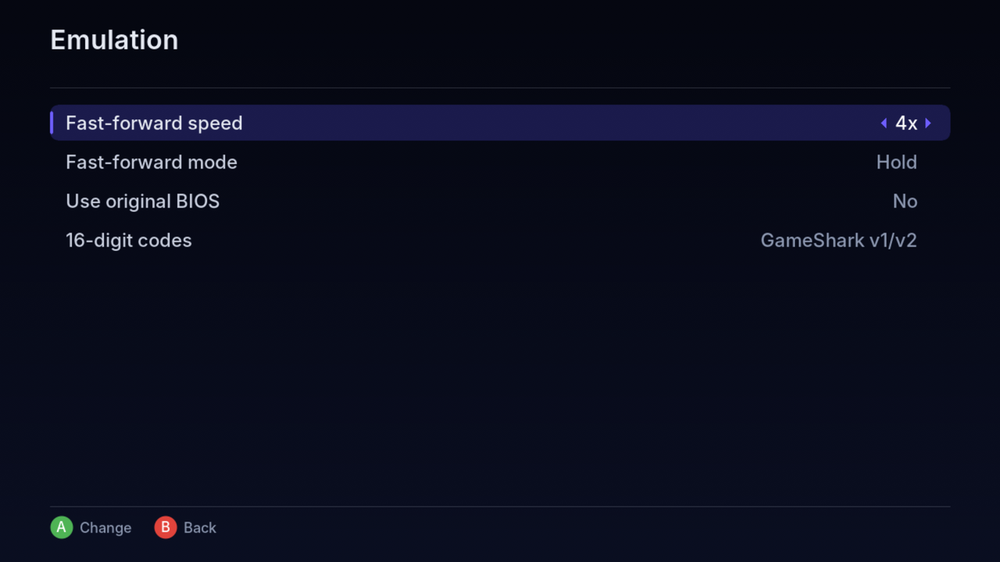 |
| 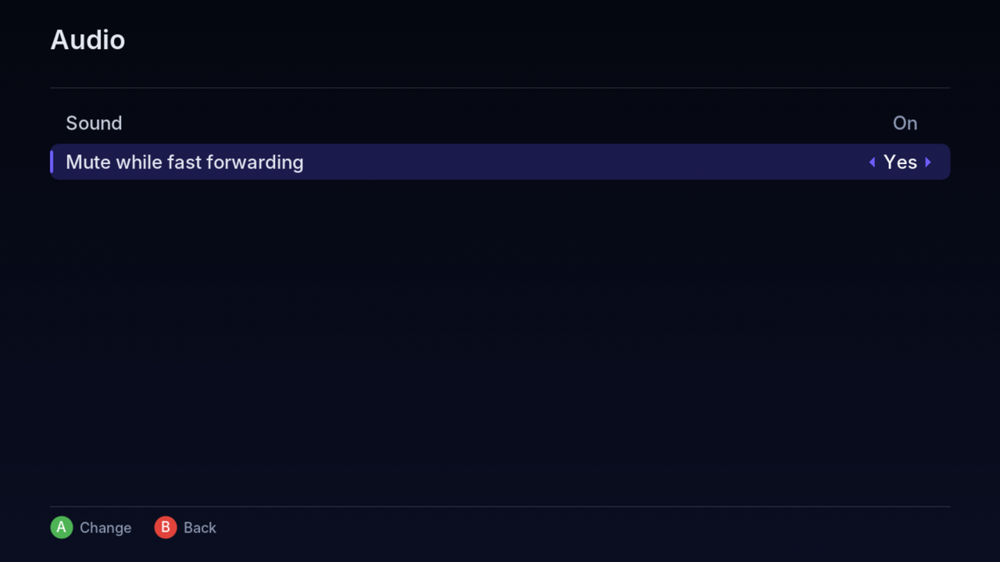 | 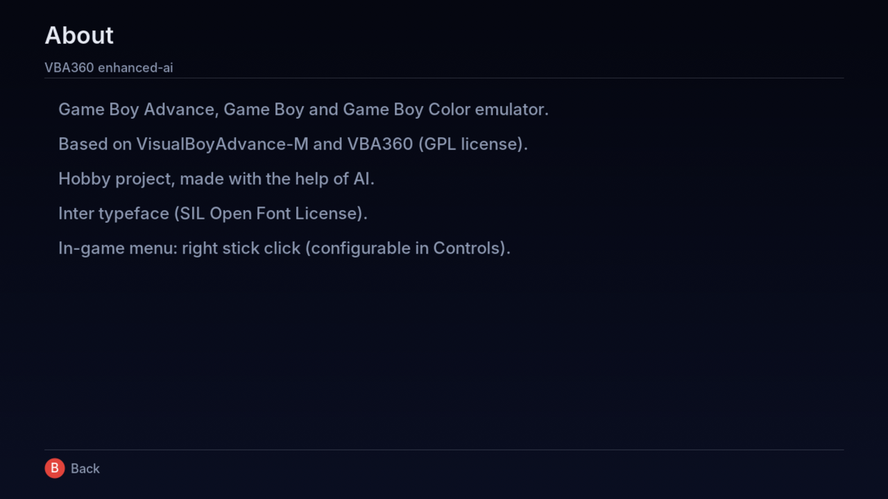 |
| 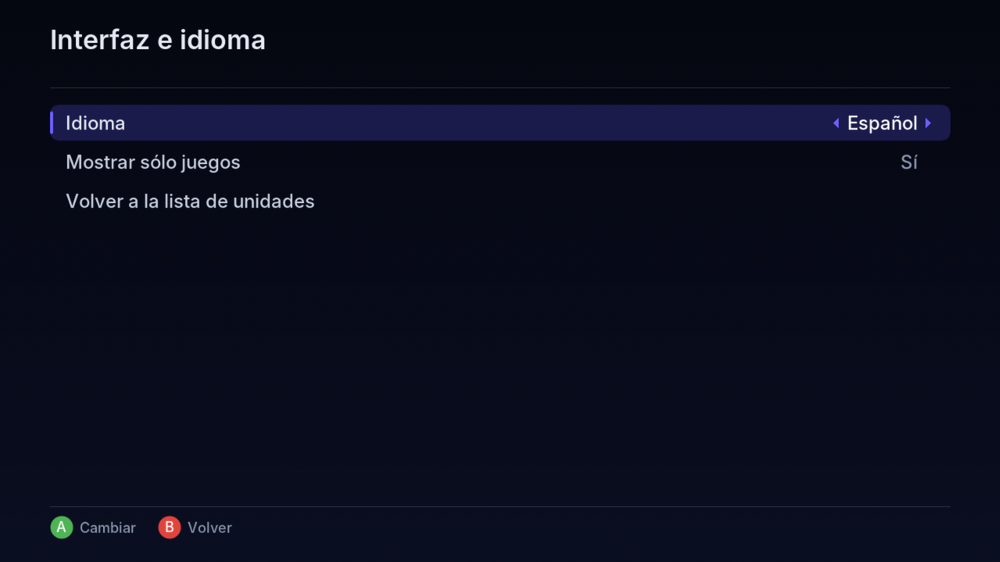 | 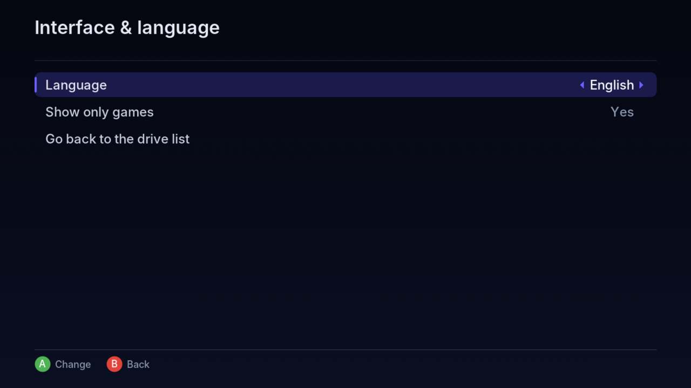 |

## Cómo usar un hack

Hay dos formas:

**1. Hack ya parchado (`.gba`).** Ábrelo como cualquier otro juego. Los hacks distribuidos como `.gba` arrancan y guardan normal; por ejemplo, el **Pokémon SoulGold** de las capturas es un hack de GBA en este formato. Es la forma recomendada, porque rinde mejor.

**2. ROM limpia + parche.** Pon la ROM limpia y el parche en la misma carpeta, con **el mismo nombre**:

```
Pokemon Unbound.gba
Pokemon Unbound.bps
```

Al abrir la ROM, el parche se aplica solo, en memoria. Ojo: con parches puede haber caídas de rendimiento (ver [Errores conocidos](#errores-conocidos)); si te pasa, usa la ROM ya parchada.

## Fondo de la pantalla

Por defecto el fondo alrededor del juego es **negro**. Para usar una imagen, ponla en la carpeta `borders\` junto a `default.xex` (puedes tener varias, con cualquier nombre) y elígela en **Ajustes → Video → Fondo de la pantalla**. Formatos: **PNG, JPG, BMP, TGA y DDS** (WebP no). Lo ideal es 1280×720, pero con **Ajuste del fondo** puedes dejarla **Centrada** (completa, al centro), **Rellenar** (cubre toda la pantalla) o **Estirar**. El juego se dibuja encima, así que solo se ven los lados. Hay un ejemplo en [`extras/borders/border.png`](extras/borders/border.png).

**Medidas para diseñar tu propio fondo** (imagen de **1280×720**, ajuste *Centrada* o *Estirar*; en 1920×1080 multiplica todo por 1.5). El juego tapa este rectángulo:

| Consola | Tamaño de imagen | Rectángulo del juego (x, y, ancho × alto) | Espacio libre a los lados |
|---|---|---|---|
| GBA | Original | 100, 0, 1080 × 720 | 100 px a cada lado |
| GBA | Entera | 160, 40, 960 × 640 | 160 px a los lados, 40 px arriba y abajo |
| GB | Original / Entera | 240, 0, 800 × 720 | 240 px a cada lado |
| GBA y GB | Pantalla completa | 80, 40, 1120 × 640 | 80 px a los lados, 40 px arriba y abajo |
| GBA y GB | 16:9 | 0, 0, 1280 × 720 | ninguno (el juego cubre toda la pantalla) |

Si usas GBA y GB con el mismo fondo, deja el diseño importante en los 100 px de cada orilla.

## Efectos de pantalla y colores

En **Ajustes → Video**:

- **Efecto de pantalla:**
  - **CRT (TV antigua):** líneas de barrido que se adelgazan en colores claros y una máscara tipo rejilla de fósforo. Adaptado del shader *zfast_crt* de Greg Hogan (GPL v2+), tomado de [libretro/glsl-shaders → `crt/shaders/zfast_crt.glsl`](https://github.com/libretro/glsl-shaders/blob/master/crt/shaders/zfast_crt.glsl).
  - **LCD (pantalla portátil):** rejilla fina y subpíxeles rojo/verde/azul, como la pantalla de una portátil. Adaptado del shader *lcd3x* de Gigaherz (dominio público), tomado de [libretro/glsl-shaders → `handheld/shaders/lcd3x.glsl`](https://github.com/libretro/glsl-shaders/blob/master/handheld/shaders/lcd3x.glsl).
  - Los dos se tradujeron de GLSL (RetroArch) a HLSL para la Xbox 360 y funcionan en GBA y GB. Se ven mejor con **Tamaño de imagen → Entera**.
- **Colores (Game Boy):** 40 paletas para los juegos de Game Boy. Las de Game Boy original (DMG), Pocket, Light y las **32 de Super Game Boy** (1-A a 4-H) se tomaron del core Gambatte de RetroArch: [libretro/gambatte-libretro → `libgambatte/libretro/gbcpalettes.h`](https://github.com/libretro/gambatte-libretro/blob/master/libgambatte/libretro/gbcpalettes.h) (Sindre Aamås, GPL v2). Además: Gris (original), Verde clásico y los extras Sepia, Azul y Rojo.

## Juegos con sensores

Algunos cartuchos de GBA traían hardware extra. El emulador lo reconoce solo, por el código del juego, y lo imita con el control:

| Juego | Hardware del cartucho | Cómo se usa en la Xbox |
|---|---|---|
| *Boktai 1 y 2*, *Shin Bokura no Taiyou* | Sensor de luz solar + reloj | **Stick derecho arriba = más sol, abajo = menos** (0 a 10; aparece en pantalla). En el nivel 10 se llenan todas las barras |
| *WarioWare: Twisted!* | Giroscopio + vibración | Girar = **stick derecho** a la izquierda o a la derecha; la vibración pasa al control |
| *Drill Dozer* | Vibración | La vibración pasa al control |
| *Yoshi Topsy-Turvy*, *Koro Koro Puzzle* | Sensor de inclinación | Inclinar = **stick derecho** |

En **Ajustes → Controles**, más abajo de los botones, está la sección **Sensores (stick derecho)**:

- **Izquierda / derecha:** inclinar (Yoshi, Koro Koro) y girar (WarioWare: Twisted!).
- **Arriba / abajo:** inclinar hacia adelante o atrás.
- **Luz solar:** hacia qué lado del stick sube el sol en Boktai.
- Para mapear, elige la opción, presiona **A** y mueve el stick derecho hacia donde quieras (al revés = invertido). También puedes elegir de la lista con izquierda/derecha, o dejarlo sin asignar con **X**.
- **Sensibilidad** (50 % a 200 %) y **zona muerta**.

Los sensores **sólo se activan en los juegos que los usan**, así que el stick derecho no interfiere con nada más.

El sensor solar, el giroscopio y la vibración se adaptaron de la VisualBoyAdvance-M actual ([`src/core/gba/gbaRtc.cpp`](https://github.com/visualboyadvance-m/visualboyadvance-m/blob/master/src/core/gba/gbaRtc.cpp), GPL v2+). La escala de sol se amplió respecto a la de VBA-M (que en el nivel máximo solo mostraba 6 de 8 barras en Boktai).

## Reloj de los juegos

Los juegos de GBA con reloj (Pokémon Rubí/Zafiro/Esmeralda, Boktai...) usan la hora de la consola. En **Ajustes → Reloj de los juegos → Personalizada** puedes elegir otro año, mes, día, hora y minuto; a partir de ahí el reloj sigue avanzando normal. *Volver a la hora de la consola* lo deshace.

## Carpetas que crea el emulador

Junto a `default.xex`: `saves\`, `states\`, `cheats\`, `screenshots\`, `thumbs\`, `config\`, `borders\` y `bios\` (pon ahí `gba_bios.bin` si quieres usar la BIOS original). La configuración se guarda en `vba360.ini`.

## Limitaciones

- **Game Boy Advance y Game Boy; no Game Boy Color.** Los juegos de Game Boy (`.gb`) funcionan. Los cartuchos compatibles con ambas consolas (`.gbc` "negros") arrancan en modo Game Boy, con la paleta elegida. Los juegos **solo** para Game Boy Color (como Pokémon Cristal o Super Mario Bros. Deluxe) no son compatibles.
- **Parte de los juegos de GBA que requieren aditamentos no funcionan:**
  - **Classic NES Series / Famicom Mini** (los juegos de NES para GBA, como *Super Mario Bros.*): usan protecciones especiales y no arrancan.
  - Accesorios como el **e-Reader** o el cable link tampoco se emulan.

## Errores conocidos

- ~~**Líneas de colores / menú alrededor del juego**~~ **(solucionado):** con el fondo negro o con un efecto activo, a veces se veían líneas de colores o el menú a los lados del juego. Ahora el emulador pinta todo el fondo de negro en cada cuadro y limpia la imagen del juego al iniciar. Si aun así llegara a pasar, usar una **imagen de fondo** lo evita (Ajustes → Video → Fondo de la pantalla).

- **Rendimiento con parches:** los juegos que se cargan con un parche **UPS / IPS / BPS** aplicado al vuelo pueden tener bajones de FPS. Los hacks ya parchados en `.gba` no tienen este problema.

## Estado

Probado en consola (BadUpdate + Aurora). Proyecto en desarrollo: si encuentras errores, abre un *issue*.

## Créditos

- **Autores originales del emulador:** Forgotten (VisualBoyAdvance) y el **equipo de VBA-M**, además del equipo de **VBA-GX**, cuyo código usa el port.
- **Port original a Xbox 360:** los autores de **VBA360** y la librería **libSDLx360**, con apoyo de **Team Avalaunch** y **Team XeLove**.
- **Fork vba360-enhanced:** [**frankischilling**](https://github.com/frankischilling), que arregló la compilación del port y es la base de este proyecto.
- **Este fork (vba360-enhanced-ai):** [**Axel** (axelconde7w7-gif)](https://github.com/axelconde7w7-gif). Idea, pruebas en consola, compilación y capturas.
- **Programación con IA:** **Claude** (de [Anthropic](https://www.anthropic.com)). Escribió los cambios de código y la documentación de este fork.
- **Fuente de la interfaz:** [Inter](https://rsms.me/inter/), de Rasmus Andersson (licencia SIL OFL).
- **Efectos de pantalla:** adaptados de [libretro/glsl-shaders](https://github.com/libretro/glsl-shaders): *zfast_crt* de Greg Hogan (GPL v2+) para CRT y *lcd3x* de Gigaherz (dominio público) para LCD.
- **Paletas de Game Boy:** tomadas del core [Gambatte de libretro](https://github.com/libretro/gambatte-libretro) (Sindre Aamås, GPL v2): Game Boy original, Pocket, Light y las 32 de Super Game Boy.
- **Sensores del cartucho** (sol, giroscopio, vibración): adaptados de la [VisualBoyAdvance-M actual](https://github.com/visualboyadvance-m/visualboyadvance-m) (GPL v2+).
- **Sonido de Game Boy y lectura de archivos comprimidos:** Gb_Apu, Blip_Buffer y File_Extractor de Shay Green (blargg).

La lista completa de créditos y librerías está en el [README original](#original-readme-vba360-enhanced).

---

# Original README (vba360-enhanced)

> Texto original del proyecto en el que se basa este fork (en inglés) Algunas funciones que menciona, como Game Boy Color, no funcionan en este fork; ver [Limitaciones](#limitaciones).

An enhanced Xbox 360 port of VisualBoyAdvance-M (VBA-M), a Game Boy and Game Boy Advance emulator.

> **Note:** This can also be built with newer versions of Visual Studio and the Xbox 360 SDK/XDK. If you want to update from Visual Studio 2008, try using Visual Studio 2010. Confirmed working on Xbox 360 SDK 21256.3.

## ⚠️ Work in Progress

**IMPORTANT:** This project is currently a **work in progress** focused solely on fixing build issues and getting the source code to compile and run on Xbox 360. **No new features are being added at this time.** The goal is to restore functionality and ensure the existing codebase builds successfully.

## About

vba360-enhanced is based on VisualBoyAdvance-M (VBA-M), ported to the Xbox 360 platform. This project aims to provide a functional Game Boy and Game Boy Advance emulator for Xbox 360 users.

### Background of VBA

In 2004, Forgotten created the original VisualBoyAdvance (VBA) emulator. At the time, VBA was being released through vba.ngemu.com. Following the initial release, the project was handed over to the VBA team.

Development of the original VBA ceased in 2004 with the release of 1.8 beta 3. However, the project continued through various developers aiming to improve VBA but not united in their efforts to do so. These "forked" versions improved on the original VBA but needed focus and unity to capture all the different improvements being accomplished.

### The Rise of VBA-M

In an effort to bring some cohesion to the multiplicity of releases, a version named VBA-M was created. VBA-M is now in active development, with updates as current as November 2009.

In addition to the DirectX version for the Windows platform, there is also one based on SDL, the free, platform-independent, graphics library. VBA is available for a variety of operating systems, such as Linux, BSD, Mac OS X, Xbox, and BeOS. VisualBoyAdvance has also been ported to GameCube and Wii.

### About VBA360

Visual Boy Advance 360 (VBA360) is an Xbox 360 port of VBA-M. This enhanced version (vba360-enhanced) is based on that work, with a focus on fixing build issues and ensuring the codebase compiles and runs correctly on Xbox 360.

Some code parts of VBA-GX are used in VBA360. Credit to the VBA-GX coders for their hard work.

VBA360 uses libSDLx360 (SDL libraries for the Xbox 360), which is included in this project.

## Features

- Game Boy Advance / Game Boy / Game Boy Color / Super Game Boy emulation
- Graphics / Sound / Controller support
- Savestate and Battery save support
- Enhanced Graphics Filter support
- Bilinear / Point hardware filtering
- Compressed ROM Support (.zip, .7z)
- Favorites Support
- Supports 64k/128k Flash Saves
- Turbo support (Right Trigger)
- In-game menu activation via right thumbstick

**Note:** These features are from the original VBA360 port. This enhanced version focuses on fixing build issues to ensure these features work correctly.

## Credits

### Original Developers

- **Forgotten** (1999-2003) - Original VisualBoyAdvance developer
- **VBA Development Team** (2004-2006) - VisualBoyAdvance-M development team
- **VBA-GX Team** - Code parts from VBA-GX are used in VBA360
- **VBA360 Original Port** - Xbox 360 port of VBA-M
- **Team Avalaunch** - Xbox development tools and support
- **Team XeLove** - Xbox development community support

### Third-Party Libraries

This project uses the following open-source libraries:

- **SDL (Simple DirectMedia Layer)** - Cross-platform multimedia library
  - Ported to Xbox 360 as libSDLx360 (also referred to as libSDL360x)
  - Copyright (C) 1997-2002 Sam Lantinga
  - Source code available separately at: https://github.com/frankischilling/libSDLx360

- **libpng** - PNG image format library
  - Version 1.4.0
  - Copyright (C) 1998-2002, 2004, 2006-2010 Glenn Randers-Pehrson

- **zlib** - Compression library
  - Copyright (C) 1995-2010 Jean-loup Gailly and Mark Adler

- **File_Extractor** - Archive extraction library
  - Version 1.0.0
  - Author: Shay Green <gblargg@gmail.com>
  - License: GNU LGPL 2.1 or later

- **SDL_ttf** - TrueType font rendering for SDL
  - Ported to Xbox 360 as SDL_ttf360

## License

This program is free software; you can redistribute it and/or modify it under the terms of the GNU General Public License as published by the Free Software Foundation; either version 2, or (at your option) any later version.

This program is distributed in the hope that it will be useful, but WITHOUT ANY WARRANTY; without even the implied warranty of MERCHANTABILITY or FITNESS FOR A PARTICULAR PURPOSE. See the GNU General Public License for more details.

You should have received a copy of the GNU General Public License along with this program; if not, write to the Free Software Foundation, Inc., 59 Temple Place - Suite 330, Boston, MA 02111-1307, USA.

## Building

### Requirements

- Microsoft Visual Studio 2008 (or compatible)
- Xbox 360 SDK
- Xbox 360 development kit or compatible environment

### Build Instructions

1. Open `vbam.sln` in Visual Studio
2. Ensure all dependencies are properly configured:
   - `libSDLx360` must be built first
   - `File_Extractor` library must be available
3. Select the desired configuration (Debug, Release, or Release_LTCG)
4. Build the solution

### Project Structure

- `src/` - Main source code
- `libSDLx360/` - SDL library port for Xbox 360
- `SDL_ttf360/` - SDL_ttf library port for Xbox 360
- `dependencies/` - Third-party dependencies
- `Skin/` - Xbox 360 UI skin files

### Technical Notes

**emucrc32.c Implementation:**

This project uses `emucrc32.c`, a portable CRC32 wrapper originally developed for [snes360-enhanced](https://github.com/frankischilling/snes360-enhanced). This file provides a flexible CRC32 implementation that can work with or without zlib:

- When `HAVE_ZLIB` is defined, it uses zlib's `crc32()` function
- When `EMUCRC32_STANDALONE` is defined, it uses a self-contained CRC32 implementation
- Provides compatibility functions (`emu_crc32()`, `calc_crc32()`) expected by older emulator codebases
- Also provides `crc32()` wrapper for unzip code compatibility

This shared implementation ensures consistent CRC32 handling across both snes360-enhanced and vba360-enhanced projects.

## Current Status

✅ **Build Status: The project now builds and runs successfully on Xbox 360!**

This project has completed the initial phase of fixing compilation and build issues. The codebase now compiles without errors and runs on Xbox 360 hardware. Recent fixes include:

- Fixed zlib compilation errors (added `HAVE_ZLIB` preprocessor definition)
- Fixed SDL header include issues
- Fixed PNG I/O for Xbox 360 HANDLE-based file operations
- Fixed library linking paths
- Added missing zlib source files (`crc32.c`, `explode.c`, `unreduce.c`, `unshrink.c`)
- Added stub implementation for `SDL_AppActiveInit`
- Created Xbox 360 image configuration file (`xex.xml`)
- Uses `emucrc32.c` - A portable CRC32 wrapper originally developed for [snes360-enhanced](https://github.com/frankischilling/snes360-enhanced) and now shared across both projects

**Next Steps:** With the build issues resolved, the next phase will focus on adding new features and improvements to enhance the emulator's functionality and user experience.

## Known Issues

- This is a work in progress - functionality may be incomplete or unstable
- Some features may not work as expected
- Performance may vary depending on the Xbox 360 hardware configuration

## Disclaimer

This software is provided for educational and research purposes. Users are responsible for ensuring they have the legal right to use any ROM files with this emulator. The developers do not condone piracy or copyright infringement.

## Background and Notes

The Xbox 360 scene already has a port of XeBoyAdvance, which is a top class emulator. Props to LoveMHZ for his hard work and efforts, especially considering it was developed on a retail kit.

Visual Boy Advance 360 started out as a simple proof of concept project. The original VBA360 port was developed as a learning project to understand PPC architecture and optimization techniques for the Xbox 360 platform.

This enhanced version (vba360-enhanced) continues that work by focusing on fixing build issues and ensuring the codebase compiles and runs correctly. The source code has been provided in the interests of the scene and GPL compliance.

**Note:** The codebase may contain some "quick and dirty" hacks and optimizations from the original proof of concept. You have been warned.

## Acknowledgments

Special thanks to:
- The original VisualBoyAdvance and VBA-M development teams
- The VBA-GX development team
- The original VBA360 port developers
- LoveMHZ for XeBoyAdvance (an excellent alternative Xbox 360 GBA emulator)
- All contributors to the open-source libraries used in this project
- The Xbox 360 homebrew development community

---
**Note:** This project is not affiliated with, endorsed by, or associated with Nintendo, Microsoft, or any other company. Game Boy and Game Boy Advance are trademarks of Nintendo Co., Ltd., or associated with Nintendo, Microsoft, or any other company. Game Boy and Game Boy Advance are trademarks of Nintendo Co., Ltd.
